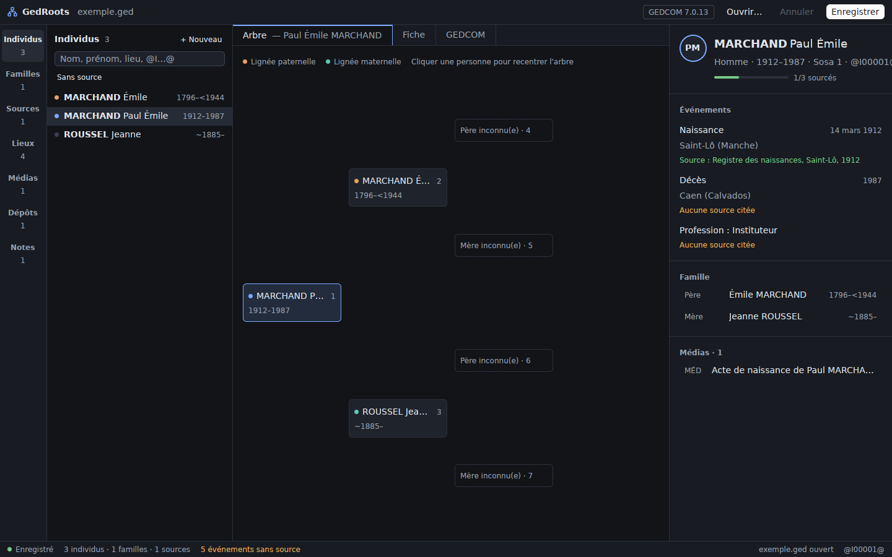
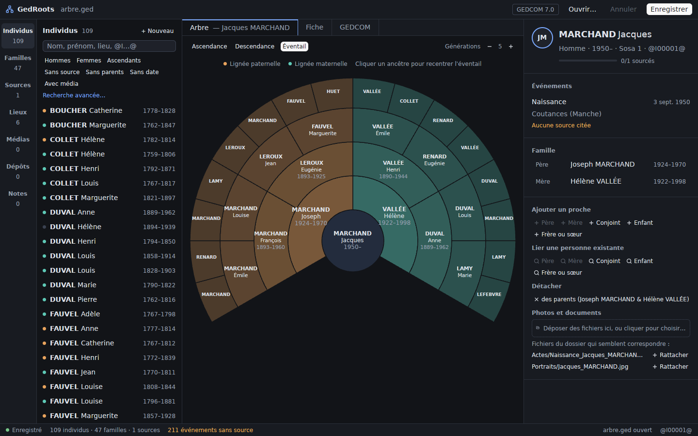
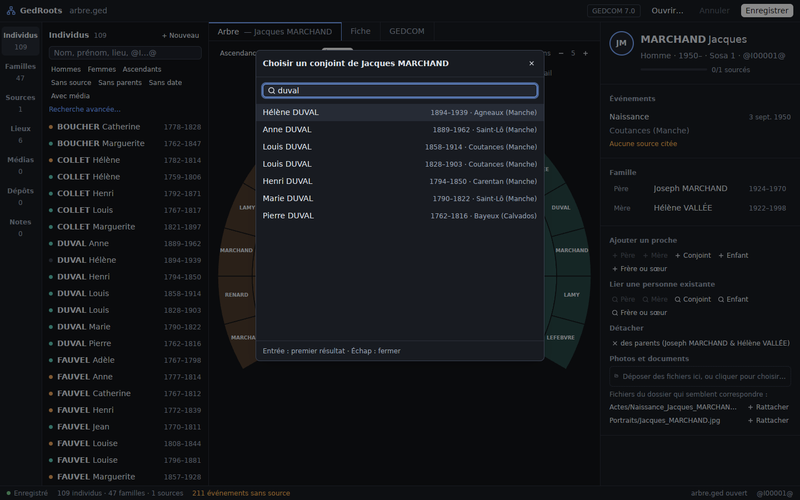
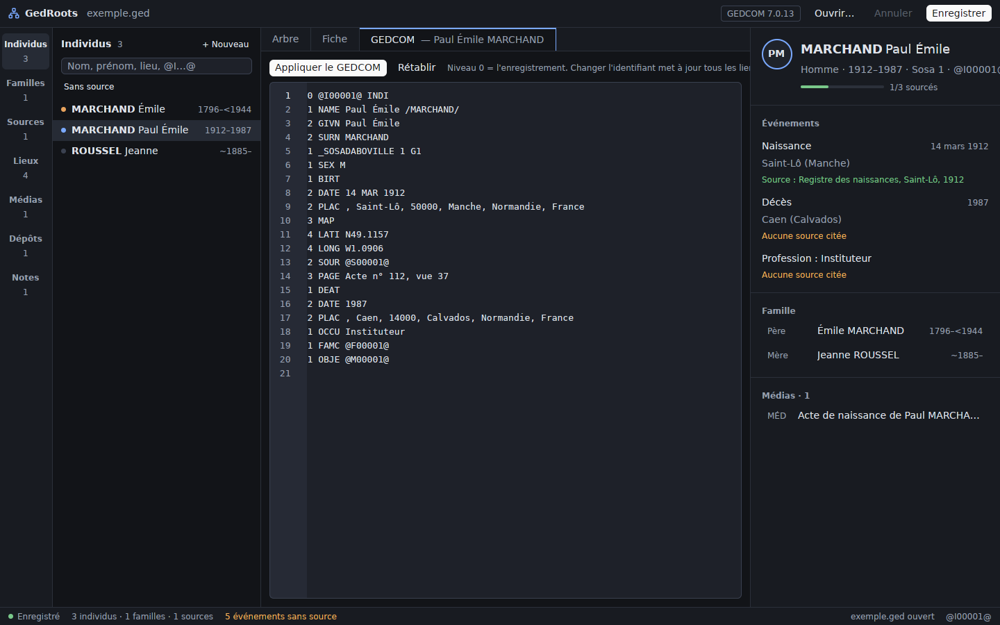

# GedRoots

Logiciel de généalogie **libre et local**, écrit en Rust avec [GPUI](https://www.gpui.rs/)
(via [GPUI Kit](https://gpui-kit.com)). Les données restent dans un fichier **GEDCOM 7**
sur votre disque : pas de base de données, pas de compte, pas de cloud.

L'interface reprend les fonctions principales d'[Ancestris](https://www.ancestris.org)
et suit la maquette « Lignée » (thème sombre, barre d'activité, liste, arbre, fiche).



## Fonctionnalités

- **Individus** : liste avec recherche sans accents ni casse et critères
  (`né:1800-1850`, `mort:<1900`, `vécu:1870`, `lieu:troyes`, `prof:meunier`, `sexe:f`,
  `sans:source`, `sans:parents`, `avec:média`, `sosa:1-63`…), filtres rapides en un clic ;
  fiche avec événements (dates en français, calendrier républicain compris), sources citées,
  famille (parents, conjoints, enfants) cliquable.
- **Arbres** : ascendance (4 générations, lignées paternelle/maternelle, numéros Sosa),
  descendance (2 à 8 générations) et **éventail** (2 à 7 générations), cliquables pour recentrer.
- **Ajouter un proche** en un clic depuis une personne (père, mère, conjoint, enfant, frère ou
  sœur), ou **lier une personne existante** via un sélecteur qui propose d'abord les dates
  plausibles ; détacher une personne d'une famille. Les liens `FAMS`/`FAMC` ↔ `HUSB`/`WIFE`/`CHIL`
  restent cohérents, et une famille vidée est supprimée.
- **Photos et actes** : glisser-déposer ou choisir des fichiers sur une personne, une famille ou
  une source ; suggestions des fichiers du dossier (`Actes/`, `Portraits/`…) dont le nom contient
  celui de la personne ; liste des fichiers du dossier sans média, importables en un clic.
- **Familles, sources, dépôts, médias, notes partagées** : liste, éditeur visuel,
  et panneau « Utilisé par / Liens » pour naviguer entre les enregistrements.
- **Lieux** : index de tous les `PLAC` du fichier, renommage global et coordonnées (`MAP`).
- **Médias / photos** : aperçu des images, chemins relatifs au fichier `.ged`.
- **Éditeur visuel** pour les enregistrements courants (individu, famille, source, dépôt,
  média, note) : seuls les champs affichés sont modifiés, tout le reste est conservé.
- **Éditeur GEDCOM brut** pour chaque enregistrement, avec validation ; changer un
  identifiant met à jour tous les pointeurs.
- Créer / supprimer un enregistrement (avec confirmation ; un lieu peut être retiré de tous
  les événements), annuler (50 niveaux), date de modification `CHAN`
  mise à jour comme dans Ancestris.
- Enregistrement **sans perte** : un fichier relu puis réécrit est identique à l'octet près
  (balises propriétaires `_SOSADABOVILLE`, `_TODO`… comprises). Une copie `.ged.bak` est
  gardée à chaque enregistrement.







## Lancer

```sh
cargo run --release -- chemin/vers/arbre.ged
```

Sans argument, l'app propose d'ouvrir un fichier ou d'en créer un nouveau.
Raccourcis : `⌘O` / `Ctrl+O` ouvrir, `⌘S` / `Ctrl+S` enregistrer, `⌘N` nouveau,
`⌘⇧Z` annuler la dernière modification du document.

Sous Linux, installer d'abord les dépendances de GPUI :
`libxkbcommon-dev libxkbcommon-x11-dev libfontconfig-dev libwayland-dev libvulkan-dev`.

## Organisation du code

| Crate | Rôle |
| --- | --- |
| [`crates/gedcom`](crates/gedcom) | Lecture/écriture GEDCOM 7 sans perte, vues typées (individus, familles, sources, lieux, médias), formulaires d'édition, dates, recherche (`search.rs`), ajout/liaison de proches et médias (`relations.rs`), descendance (`pedigree.rs`). Sans dépendance. |
| [`crates/gedroots`](crates/gedroots) | Application GPUI : `workspace.rs` (fenêtre et vues) et `workspace/` (`tree.rs` arbres, `relatives.rs` proches/sélecteur/médias, `filters.rs` filtres rapides), `editor.rs` (éditeurs visuel et brut), `theme.rs` (palette de la maquette). |

## Tests

```sh
cargo test -p gedcom
# Vérifier qu'un vrai fichier est relu et réécrit à l'identique :
GEDROOTS_TEST_GED=~/Genealogie/arbre.ged cargo test -p gedcom real_file -- --nocapture
```

Le fichier d'exemple `crates/gedcom/tests/fixtures/exemple.ged` est fictif. Les fichiers
`.ged` personnels sont ignorés par git.
