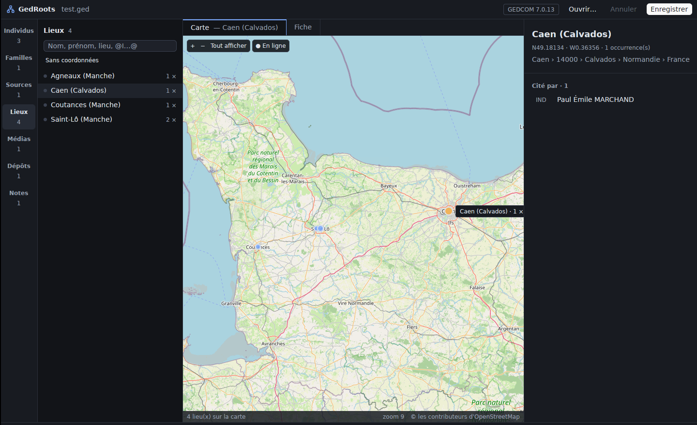
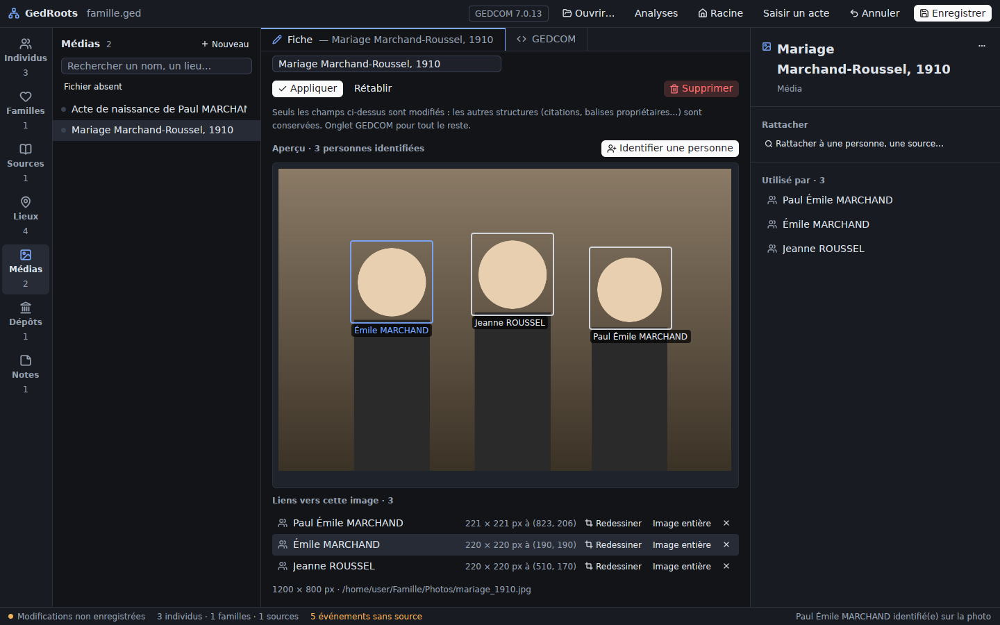
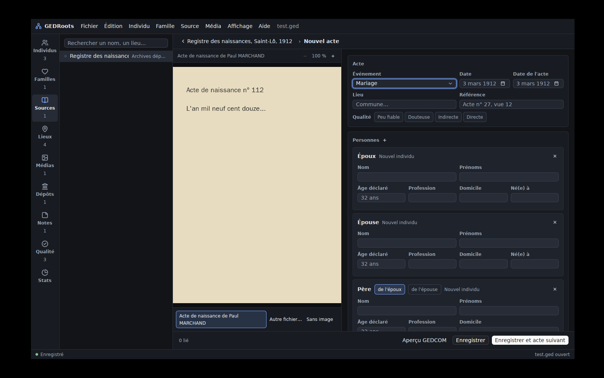

# GEDRoots

Logiciel de généalogie **libre et local**, écrit en Rust avec [GPUI](https://www.gpui.rs/)
(via [GPUI Kit](https://gpui-kit.com)). Les données restent dans un fichier **GEDCOM 7**
sur votre disque : pas de base de données, pas de compte, pas de cloud.

L'interface reprend les fonctions principales d'[Ancestris](https://www.ancestris.org)
et suit le [design system GEDRoots](design.md) (fonds neutres et touches de violet, police Inter, clair ou sombre selon le système).


## Fonctionnalités

- **Tout est dans la barre de menus** (Fichier, Édition, Individu, Source, Média,
  Affichage, Aide) : pas de barre d'outils, l'écran reste aux données. Menus natifs
  sous macOS ; sous Linux et Windows, les mêmes menus dans le haut de la fenêtre. Les commandes
  qui ne s'appliquent pas à la sélection sont grisées (macOS) ou sans effet.
- **Palette de commandes** (`⌘⇧P` / `Ctrl+Maj+P`) : toutes les commandes applicables, recherche
  sans accents. Raccourcis : `⌘1`…`⌘8` listes et pages, `⌥⌘1`…`⌥⌘3` arbre/fiche/GEDCOM, `⌘F`
  rechercher, `⌘⇧N` nouvel élément, `⌘⇧H` individu racine, `⌘=` / `⌘-` générations de l'éventail,
  `⌘⇧S` enregistrer sous.
- **Clic droit partout** : lignes des listes (et le fond, pour créer), cases des arbres et de
  l'éventail, cases vides (nouvelle personne ou personne existante), événements, proches,
  liens et vignettes du panneau de détail, repères et fond de la carte
  (« Placer ce lieu ici »). Le menu agit sur l'élément cliqué sans le sélectionner, avec les
  mêmes commandes que la barre de menus.
- **Événements modifiables** : un clic sur un événement (individu ou union) le rouvre dans
  la même fenêtre que l'ajout (type, précision, date, lieu suggéré, source) ; on peut aussi le
  supprimer. Notes, âge, médias et autres citations de l'événement sont conservés.
- **Chronologie unifiée** : la fiche d'un individu montre ses événements et ceux de ses unions
  (mariage, divorce… « avec » le conjoint) dans une seule liste par date, avec son âge à chaque
  événement ; on y ajoute aussi un mariage directement. Le bouton à côté du « + » (ou
  Affichage › Événements des proches) y mêle les naissances et décès de ses parents, frères et
  sœurs, conjoints, enfants et petits-enfants survenus de son vivant. Chaque événement affiche ses médias (`2 OBJE`, GEDCOM 7 standard) :
  déposer des fichiers sur l'événement les y rattache, le clic droit permet d'en rattacher,
  de lier un média existant ou d'en détacher.
- **Individus** : liste avec recherche sans accents ni casse et critères
  (`né:1800-1850`, `mort:<1900`, `vécu:1870`, `lieu:troyes`, `prof:meunier`, `sexe:f`,
  `sans:source`, `sans:parents`, `sans:mariage`, `avec:média`, `sosa:1-63`…), filtres rapides (Affichage › Filtrer la liste) ;
  fiche avec portrait, galerie d'images, événements (dates en français, calendrier républicain compris), sources citées,
  famille (parents, conjoints, enfants) cliquable.
- **Pas d'onglet Familles** : une union (`FAM`) se gère depuis la fiche de chacun des conjoints
  (événements d'union, enfants, photos et notes du couple). Avec plusieurs unions, la fenêtre
  « + » propose « Enfant avec … » pour chacune, et le clic droit sur un conjoint « Ajouter un
  enfant à ce couple ». Un conjoint ajouté à un parent seul rejoint son union existante. Un lien
  vers une famille (Qualité, « Cité par »…) ouvre la fiche d'un conjoint.
- **Arbres** : **arbre libre** (ascendants à droite, descendants et conjoints à gauche, frères et
  sœurs au-dessus ; on s'y déplace en glissant ou à la molette, les générations se chargent au fur et
  à mesure dans les deux sens, une mini-carte montre où l'on est, double-clic pour recentrer) et
  **éventail** (2 à 7 générations).
- **Ajouter un proche** en un clic depuis une personne (père, mère, conjoint, enfant, frère ou
  sœur), ou **lier une personne existante** via un sélecteur qui propose d'abord les dates
  plausibles ; détacher une personne d'une famille. Les liens `FAMS`/`FAMC` ↔ `HUSB`/`WIFE`/`CHIL`
  restent cohérents, et une famille vidée est supprimée.
- **Photos et actes** : glisser-déposer ou choisir des fichiers sur une personne ou
  une source ; suggestions des fichiers du dossier (`Actes/`, `Portraits/`…) dont le nom contient
  celui de la personne ; les fichiers du dossier sans média sont dans Qualité › Fichiers à
  rattacher (menu Média › Fichiers à rattacher).
- **Sources, dépôts, médias, notes partagées** : liste, éditeur visuel,
  et panneau « Utilisé par / Liens » pour naviguer entre les enregistrements.
- **Lieux** : index de tous les `PLAC` du fichier, renommage global et coordonnées (`MAP`).
- **Carte des lieux** : tous les lieux ayant des coordonnées sur une carte OpenStreetMap
  (glisser pour déplacer, molette pour zoomer, clic sur un repère pour ouvrir le lieu).
  Les lieux sans coordonnées se localisent un par un depuis Qualité › Lieux sans coordonnées
  (« Localiser… », via Nominatim), pour vérifier chaque résultat, ou se placent à la main (clic
  droit sur la carte) ; les coordonnées sont écrites dans le GEDCOM (`PLAC.MAP.LATI/LONG`,
  format `N49.11652` / `W1.11437`) et s'annulent comme toute modification. Les tuiles sont
  gardées en cache sur le disque : en mode « Hors ligne », rien ne part sur Internet.



- **Médias / photos** : portraits des individus, images des sources (actes numérisés)
  dans la fiche et le panneau de détail, chemins relatifs au fichier `.ged`.
- **Recadrage et identification des personnes** : sur la fiche d'une photo, Média › « Identifier une
  personne sur la photo » puis tracer un cadre autour du visage et choisir la personne. C'est le `CROP`
  standard de GEDCOM 7 sur le lien `INDI → OBJE` (pas d'extension, lisible par les autres
  logiciels) : la photo de groupe affiche les noms, le portrait et les vignettes de la personne
  sont recadrés sur son visage. Chaque lien vers une image (source, famille…) peut aussi être
  délimité, par exemple l'extrait utile d'un registre.
- **Liens web** (page d'un acte aux archives en ligne, fiche Geneanet…) : section « Liens web »
  du panneau de détail, cliquable (ouverture dans le navigateur), avec « + », modifier et
  retirer ; aussi Édition › « Ajouter un lien web… ». Stockés en GEDCOM 7 standard : lien
  multimédia vers un `OBJE` dont le `FILE` est l'URL (`FORM text/html`), et `WWW` pour les
  dépôts.
- **Assistant d'import** (Fichier › « Importer un GEDCOM… ») : ouvre un fichier venu d'un autre
  logiciel, liste ce qu'il contient de non standard et propose de le convertir en GEDCOM 7
  (annulable). Premier contrôle : les balises `_URL` deviennent des liens multimédia (`WWW`
  pour les dépôts). Les contrôles sont dans `crates/gedcom/src/import.rs`.
- **Réglages du fichier** (⌘ / Ctrl + `,` ; menu GEDRoots sur macOS, Fichier ailleurs) : auteur, e-mail, droits,
  description, langue et individu racine, plus la liste des anomalies masquées (« Réafficher »).
  Tout est rangé dans l'en-tête du .ged en GEDCOM 7 standard (`HEAD.SUBM`, `COPR`, `NOTE`,
  `LANG`). À chaque enregistrement, `HEAD.SOUR` et `HEAD.DATE` indiquent GEDRoots et la date.
  - **Lieux** : format des lieux (`HEAD.PLAC.FORM`) — juridictions à renommer, réordonner,
    ajouter ou retirer, avec réécriture de tous les lieux du fichier (annulable) et un aperçu.
    La fiche d'un lieu propose un champ par juridiction, et les libellés courts (« Troyes
    (Aube) ») suivent ce format.
  - **Événements** : types d'événements personnalisés (`EVEN` + `TYPE`), déduits du fichier,
    à renommer ou fusionner ; un nouveau type est déclaré par l'extension
    [`_GR_EVEN`](docs/extensions.md#_gr_even). Ils sont proposés dans « Ajouter un événement… ».
  - **Médias** : dossier des médias et sous-dossiers (Actes, Portraits…), chacun avec les
    événements qu'il reçoit (menu à cocher) et son modèle de nom (`{sosa:6}_{fratrie}_{type:1}_{nom}_{prenom}`…,
    numéros Sosa-d'Aboville calculés depuis la racine), extension
    [`_GR_MEDIA`](docs/extensions.md#_gr_media), avec un exemple par sous-dossier. Un fichier
    rattaché depuis l'extérieur est copié à sa place ; Média › « Renommer selon le modèle… »
    range les fichiers d'un média existant.
- **Médias à plusieurs pages** : un acte sur deux feuillets est un seul média (`OBJE` avec un
  `FILE` par page, standard GEDCOM 7). Visionneuse page par page (miniatures, ⇞ / ⇟), pages
  ajoutées par glisser-déposer ou Média › Pages, réordonnées en glissant les miniatures, retirées
  ou séparées en un nouveau média. Pour fusionner des médias existants : ⌘ / Ctrl + clic ou Maj + clic
  dans la liste des médias, puis « Fusionner » (ou clic droit, ou Média › Fusionner avec un autre
  média…). Tous les liens sont réécrits ; une personne située sur la page 2 garde son cadre
  (extension [`_GR_FILE`](docs/extensions.md#_gr_file)).


- **Individu racine** : enregistré dans le fichier lui-même (extension `_GR_ROOT`, voir
  [docs/extensions.md](docs/extensions.md)), jamais dans un fichier annexe.
- Les identifiants GEDCOM n'apparaissent pas dans l'interface : liens choisis par nom
  (époux, dépôt…), identifiant accessible via **… → Copier l'ID** et l'onglet GEDCOM.
- **Éditeur visuel** pour les enregistrements courants (individu, source, dépôt,
  média, note) : seuls les champs affichés sont modifiés, tout le reste est conservé.
- **Éditeur GEDCOM brut** pour chaque enregistrement, avec validation ; changer un
  identifiant met à jour tous les pointeurs. **Autocomplétion** selon le schéma GEDCOM 7
  officiel : balises permises à cet endroit (recherche aussi par libellé français,
  « nais » → `BIRT`), individus/familles/sources pour les pointeurs, valeurs énumérées,
  mots-clés et mois des dates (calendrier républicain compris), lieux déjà saisis.
  `Ctrl+Espace` affiche les suggestions à la demande.
- **Actes dans la fiche source** : la fiche d'une source liste ses actes (relus depuis les
  citations qui la désignent, regroupées par référence `PAGE`) ; « + » ou `⌘E` / `Ctrl+E`
  ouvre un acte vide, un clic rouvre un acte pour le corriger, clic droit pour le supprimer.
  « Nouvelle source » s'ouvre directement sur un acte vide. L'éditeur est générique, sans
  modèles : on choisit n'importe quel événement GEDCOM (ou un type personnalisé), puis on
  ajoute les personnes avec leur rôle standard (enfant, père, mère, époux, témoin, parrain,
  déclarant, officiant, voisin…) ; les champs et les liens familiaux découlent du rôle.
  Pour chaque personne, GEDRoots propose les individus existants qui correspondent (nom,
  âge, et liens déjà connus : « parent de… », « conjoint de… ») ; on peut lier, créer, ou
  mentionner sans créer. L'enregistrement écrit tout de suite l'événement, les liens
  familiaux, les témoins (`ASSO`), les professions et domiciles datés, une naissance estimée
  d'après l'âge, et toutes les citations avec leur rôle (`EVEN`/`ROLE`), sans aucune
  extension. Aperçu du GEDCOM avant d'écrire, et « Enregistrer et acte suivant » pour
  dépouiller un registre (le numéro de la référence avance tout seul).
- Créer / supprimer un enregistrement (avec confirmation ; un lieu peut être retiré de tous
  les événements), annuler (50 niveaux), date de modification `CHAN`
  mise à jour comme dans Ancestris.
- **Qualité des données** (`⌘8` / `Ctrl+8`, menu Affichage) : une page dans
  la barre de gauche, avec le nombre d'anomalies à corriger, par catégorie : dates et âges
  impossibles, liens familiaux incohérents, structure GEDCOM 7 (balise non permise,
  information obligatoire absente ou en double, date illisible, valeur inconnue, lien
  cassé), éléments vides ou isolés (événements et notes vides, familles sans membre,
  enregistrements cités nulle part, arbres séparés de la racine), médias (fichier
  introuvable, déplacé dans le dossier, médias en double, format absent), événements sans
  source, fichiers du dossier à rattacher, lieux (variantes d'un même lieu, rattachement
  incohérent comme « Loire » tantôt en « Rhône-Alpes », tantôt en « Auvergne-Rhône-Alpes »,
  coordonnées illisibles) et lieux sans coordonnées. Un clic ouvre l'élément (`⌘[` revient), le
  bouton de la ligne corrige quand c'est sûr (supprimer, rétablir un lien à sens unique,
  retirer un lien cassé, corriger le chemin, fusionner, créer le média, harmoniser), et en lot, avec
  confirmation pour les suppressions et fusions. « Localiser… » choisit à la main le
  fichier d'un média introuvable, ou ouvre le lieu sur la carte pour le localiser. Clic droit › « Masquer » écrit [`_GR_IGNORE`](docs/extensions.md).
- **Lien de parenté** (menu Individu › Lien de parenté avec…) : « cousine issue de germain »,
  « oncle à la mode de Bretagne », demi-frère, beau-père… avec le chemin par l'ancêtre commun
  et le degré civil, affiché dans le panneau de l'individu.
- **Statistiques** (`⌘8` / `Ctrl+8`, menu Affichage) : une page avec les patronymes et prénoms
  fréquents, la longévité par siècle, l'âge au mariage, la complétude de l'ascendance de
  l'individu racine par génération et l'implexe.
- Enregistrement **sans perte** : un fichier relu puis réécrit est identique à l'octet près
  (balises propriétaires `_SOSADABOVILLE`, `_TODO`… comprises). Une copie `.ged.bak` est
  gardée à chaque enregistrement.




## Installer

### macOS

```sh
packaging/macos/bundle.sh --install
```

Compile GEDRoots en mode release, construit `GEDRoots.app` (icône, nom dans la barre de menus et
le Dock, pas de Terminal) et la copie dans `/Applications`. Les fichiers `.ged` s'ouvrent ensuite
d'un double-clic ou par « Ouvrir avec » dans le Finder. Sans `--install`, l'app reste dans
`target/release/GEDRoots.app` ; avec `--dmg`, une image disque `GEDRoots.dmg` est créée à côté
(utile pour la CI). Pour un autre cargo :
`CARGO="mise exec rust@stable -- cargo" packaging/macos/bundle.sh --install`.

L'app est signée « ad hoc », ce qui suffit sur le Mac qui l'a compilée. Une app téléchargée
(le `.dmg` de la CI) est bloquée par Gatekeeper au premier lancement : clic droit › Ouvrir, ou
`xattr -dr com.apple.quarantine /Applications/GEDRoots.app`. Pour la distribuer sans cet
avertissement, il faudrait la signer avec un certificat Developer ID et la faire notariser par
Apple (compte Apple Developer payant).

### Linux

```sh
packaging/linux/install.sh
```

Installe `~/.local/bin/gedroots`, l'icône et l'entrée du menu des applications.

### Windows

`cargo build --release -p gedroots` produit `target\release\gedroots.exe`, qui s'ouvre sans
fenêtre de console.

L'icône (`packaging/icon.png`) vient du kit de marque GEDRoots (app icon sombre, posée sur la grille macOS).

## Lancer depuis les sources

```sh
cargo run --release -- chemin/vers/arbre.ged
```

Sans argument, l'app propose d'ouvrir un fichier ou d'en créer un nouveau.
Raccourcis : `⌘O` / `Ctrl+O` ouvrir, `⌘S` / `Ctrl+S` enregistrer, `⌘N` nouveau,
`⌘E` saisir un acte, `⌘⇧Z` annuler la dernière modification du document.

Variables d'environnement facultatives pour la carte : `GEDROOTS_OFFLINE=1` (démarrer hors ligne),
`GEDROOTS_TILE_URL` (autre serveur de tuiles, `{z}/{x}/{y}`), `GEDROOTS_TILE_CACHE` (dossier du
cache, par défaut `~/Library/Caches/GEDRoots/tiles` ou `~/.cache/gedroots/tiles`),
`GEDROOTS_GEOCODER` (autre instance Nominatim).

Sous Linux, installer d'abord les dépendances de GPUI :
`libxkbcommon-dev libxkbcommon-x11-dev libfontconfig-dev libwayland-dev libvulkan-dev`.

## Organisation du code

| Crate | Rôle |
| --- | --- |
| [`crates/gedcom`](crates/gedcom) | Lecture/écriture GEDCOM 7 sans perte, vues typées (individus, familles, sources, lieux, médias), recadrage `CROP` (`crop.rs`), médias multipages (`multipage.rs`), liens web (`weblink.rs`) et assistant d'import (`import.rs`), formulaires d'édition, dates, coordonnées (`geo.rs`), outils d'analyse (`analysis/`), contrôles de la page Qualité (`quality.rs`), recherche (`search.rs`), ajout/liaison de proches et médias (`relations.rs`), descendance (`pedigree.rs`) et actes des sources (`act.rs`). Sans dépendance. |
| [`crates/gedroots`](crates/gedroots) | Application GPUI : `commands.rs` (toutes les commandes, raccourcis et menus), `workspace.rs` (fenêtre et vues) et `workspace/` (`commands.rs` commandes et palette, `tree.rs` arbres, `relatives.rs` proches/sélecteur/médias, `add.rs` fenêtres d'ajout et de modification d'événement, `menus.rs` menus du clic droit, `photo.rs` recadrage et personnes sur les photos, `pages.rs` médias multipages et fusion, `weblinks.rs` liens web, `import.rs` assistant d'import, `filters.rs` filtres rapides, `quality.rs` page Qualité, `insights.rs` page Statistiques et lien de parenté), `editor.rs` (éditeurs visuel et brut), `act_editor.rs` (éditeur d'acte), `map.rs` (carte des lieux), `theme.rs` (palette de la maquette). |

## Tests

```sh
cargo test -p gedcom
# Contrôle de cohérence et statistiques d'un fichier, en ligne de commande :
cargo run -p gedcom --example analyse -- ~/Genealogie/arbre.ged
# Vérifier qu'un vrai fichier est relu et réécrit à l'identique :
GEDROOTS_TEST_GED=~/Genealogie/arbre.ged cargo test -p gedcom real_file -- --nocapture
```

Le fichier d'exemple `crates/gedcom/tests/fixtures/exemple.ged` est fictif. Les fichiers
`.ged` personnels sont ignorés par git.
