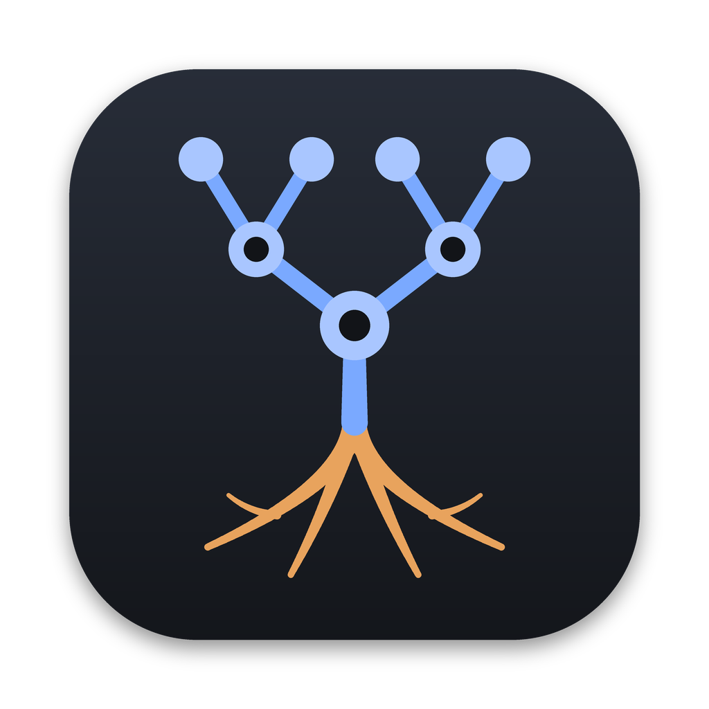
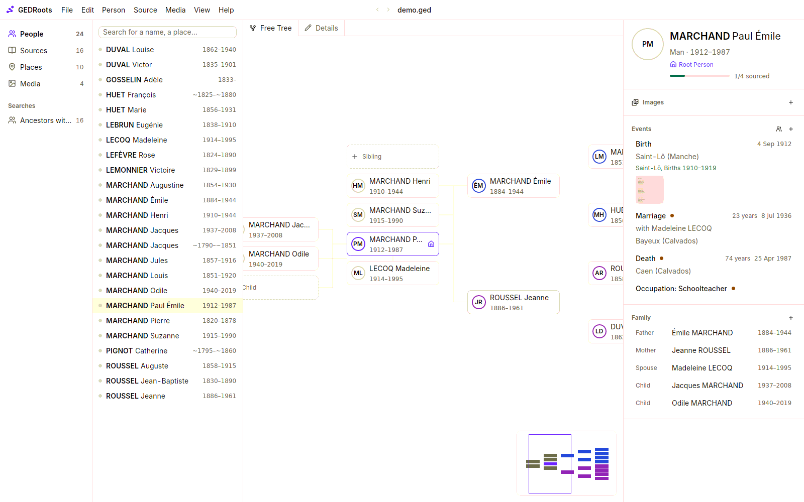

<p align="center">
  
</p>

<h1 align="center">GEDRoots</h1>

<p align="center">
  <strong>Genealogy software that respects your research.</strong><br>
  Free, local, and built on GEDCOM 7: your family tree stays a standard file on your computer.
</p>

<p align="center">
  <a href="https://gedroots.github.io/gedroots/">Documentation</a> ·
  <a href="https://gedroots.github.io/gedroots/get-started/install">Install</a> ·
  <a href="https://gedroots.github.io/gedroots/get-started/first-tree">Tutorial</a>
</p>

<picture>
  <source media="(prefers-color-scheme: dark)" srcset="website/docs/images/workspace-dark.png">
  
</picture>

## Your tree, in an open format

Most genealogy software locks your research in its own database. GEDRoots works directly on a
[GEDCOM 7](https://gedcom.io) file, the open standard every genealogy program can read. No
account, no cloud, no lock-in. A file that GEDRoots opens and saves stays identical, byte for
byte, apart from your changes, including the tags written by other software.

Available for **macOS**, **Windows** and **Linux**, in **English** and **French**.

## Enter a record once, with everyone in it

A record names several people: a child and the parents, two spouses and their witnesses, a
whole household. In GEDRoots you enter it once, in its source. GEDRoots suggests the people
already in your tree, then writes the events, the family links, the roles and the citations
for everyone, in standard GEDCOM 7. **Save and Next Record** takes you through a whole
register.


## Everything a genealogist needs

- **Family tree and fan chart.** An infinite free tree in both directions, and a fan chart of
  up to seven generations that shows at a glance which ancestors are still missing.
- **A life on one timeline.** A person's events and those of their unions, with their age at
  each, and on request the births and deaths of their close relatives.
- **Search that understands genealogy.** Type `1855`, `agneaux` or `louis marchand`: GEDRoots
  suggests *born about 1855*, *place Agneaux*, *ancestors of Louis MARCHAND*. Spelling
  variants, saved searches, and criteria such as `without:source`.
- **Media that file themselves.** Record scans are filed by event and named from your
  template, such as `001_B_MARCHAND_Paul.jpg`. Multi-page records, people tagged in group
  photos, portraits cropped to the face.
- **Places on the map.** Consistent places from your file or from OpenStreetMap, located one at
  a time, on a map that also works offline.
- **Data quality.** Impossible dates, broken family links, missing files, the same town written
  three ways: found for you, and fixed in one click when the fix is safe.
- **Research help.** See which ancestors lack a record, search them on Geneanet, FamilySearch
  or any archive website, and find how two people are related.
- **AI agents, under your control.** Connect an agent such as Claude Code: it finds the gaps,
  searches online archives and proposes records. You compare each proposal with your tree
  before anything is saved. Living people stay hidden.
- **Share freely.** GEDZIP archives with every media file, GEDCOM 5.5.1 for older software,
  and a file ready for Geneanet.

## Install

GEDRoots is built from source with [mise](https://mise.jdx.dev), which installs the right
Rust toolchain for you:

```sh
git clone https://github.com/gedroots/gedroots.git
cd gedroots
mise trust && mise install
mise run install
```

See the [installation guide](https://gedroots.github.io/gedroots/get-started/install) for
the details on each system, then [start your family tree](https://gedroots.github.io/gedroots/get-started/first-tree).

## Documentation

The [documentation](https://gedroots.github.io/gedroots/) is organized around genealogy
tasks: importing a tree, entering records, organizing media, planning research, checking data,
sharing. Its source is in [`website/`](website).

## Contributing

GEDRoots is written in Rust with [GPUI](https://www.gpui.rs/). See
[CONTRIBUTING.md](CONTRIBUTING.md) to set up the development environment, run the tests and
find your way in the code.

## License

GEDRoots is dual-licensed under the [MIT License](LICENSE-MIT) or the
[Apache License 2.0](LICENSE-APACHE), at your option. The Inter typeface is under the
[SIL Open Font License](crates/gedroots/assets/fonts/OFL.txt).
