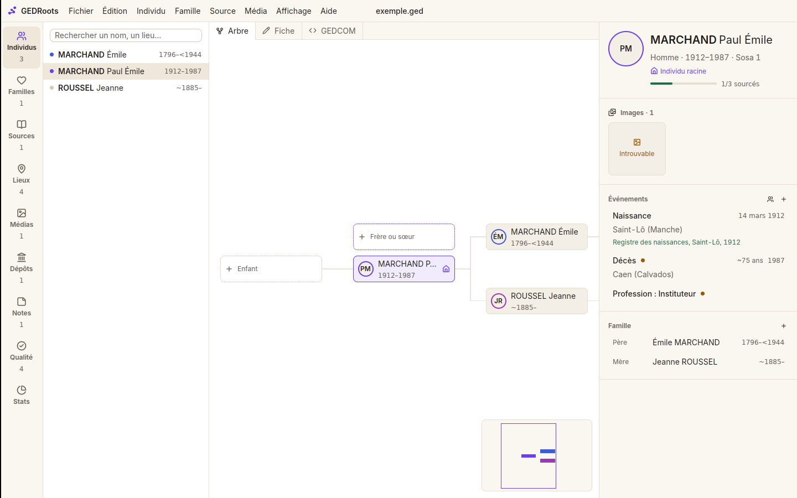
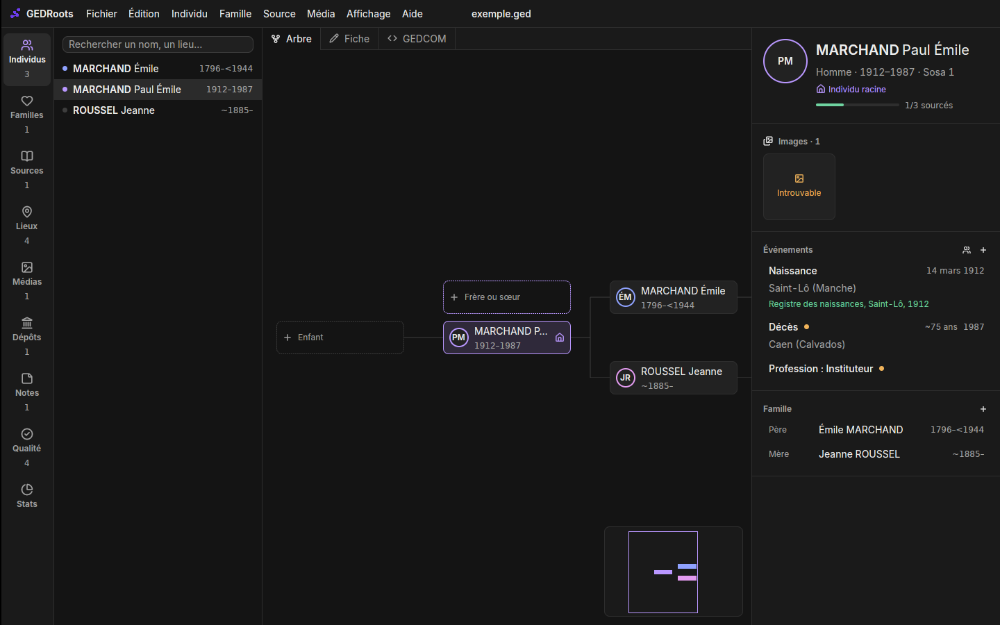

# GEDRoots design system

Taken from the GEDRoots brand kit v1.0 ("organic graph, minimalist, violet"). The reference
code is [`crates/gedroots/src/theme.rs`](crates/gedroots/src/theme.rs): views never hardcode
a colour, radius or font, they go through its tokens.

| Light | Dark |
|---|---|
|  |  |

This document gathers the design system (tokens, typography, icons) and the interface rules
taken from the [Apple HIG](https://developer.apple.com/design/human-interface-guidelines),
[GNOME HIG](https://developer.gnome.org/hig/) and [Windows / Fluent](https://learn.microsoft.com/windows/apps/design/)
guidelines, adapted to GEDRoots. When they conflict, the project rules below win, then the
convention of the platform the app runs on.

## Before any mockup

Do this **every time**, without waiting to be asked, before proposing a screen, a window or a
flow:

1. **Genealogy software.** Look at how at least three of them handle the subject, starting
   with the most relevant:
   - MacFamilyTree: polished Mac app, trees and charts, direct editing in the record;
   - Family Historian: sources and citations, witnesses (roles), diagrams, queries;
   - Heredis: the French reference, record entry, places and maps;
   - RootsMagic: citations, "Problems", duplicate handling, to-do lists;
   - Gramps: data model (shared events, roles), Linux, plugins;
   - Ancestris: native GEDCOM, French vocabulary;
   - web services (FamilySearch, Geneanet, Ancestry, Filae) for entering and presenting
     records.
2. **The best apps in general.** Look for the same pattern (list + detail, search, import,
   settings, in-place editing, map, timeline…) in at least two apps known for their design:
   Finder, Photos, Mail, Notes, Maps, Settings (macOS); Things, Linear, Figma, Zed, Obsidian,
   Raycast, Arc; Files, Fragments, Settings (GNOME); File Explorer, Photos, Settings
   (Windows 11).
3. **Platform guidelines.** Check the pattern against the Apple, GNOME and Windows HIGs, then
   against this document (Principles, Interaction and Platforms sections).
4. **Hand in the research with the mockup**: a short table "app · what it does well · what we
   take · what we avoid", with links or screenshots. No long essay.
5. **Mock up with the tokens** of this document, in light **and** dark, with the real English
   and French labels and realistic data (partial dates, long names, hierarchical places,
   empty fields).

A proposal without this research is not ready to show.

## Principles

- **Neutral backgrounds, a touch of violet**: backgrounds stay white and ochre in light mode,
  grey and black in dark mode. The primary violet only appears in touches: main action, link,
  selection, brand symbol. Never a violet background or large violet area, no gradients.
- **Data first**: the screen serves genealogy, not the interface. No decorative chrome, no
  cards inside cards, no shadows except for what floats (menus, popovers, modals).
- **Commands in the menus**: no toolbar. Each command exists once in the menu bar (the
  `commands.rs` model), so also in the `⌘⇧P` palette and, when it acts on an item, in that
  item's context menu with the same label. The only visible buttons are the small "+" in
  section headers (Events, Family, Members…) and the dashed slots of the tree.
- **No explanatory text**: one title per element; format examples go in the field
  placeholder; empty sections are hidden.
- **Progressive disclosure**: technical fields are inferred, not shown (e.g. a media's
  `FORM`); rare or destructive actions are collapsed or in menus; GEDCOM identifiers only
  appear through Edit › Copy ID and the advanced search.
- **Read first, edit in place**: a record opens as text (empty values hidden, linked records
  clickable). Edit › Edit Record (`⌘L`, like Contacts) or the small pencil next to it turns the
  same layout into fields; Done saves (one undo point), Cancel or `Esc` drops the changes. A
  new record opens on its fields. An item of a record (an event) opens read-only on click, with
  "Edit…"; a double-click edits it directly.
- **Undo rather than confirm**: every change goes through an undo point; confirmation is only
  asked for what cannot be undone (a file overwritten on disk…).
- **A single bar at the top**: on macOS the title bar is merged with the app's bar (traffic
  lights on the left, window dragging). The file name appears only once, centred, followed by
  "•" while it is unsaved. No status bar: messages show on the right of the top bar.
- **Tooltips** on every button without a label, with the shortcut when there is one.
- **Never colour alone**: lineages, states and selections also have a shape (dot, outline,
  icon, text). Colours stay readable for colour-blind users.

## Colours

The mode follows the system appearance and changes live. `GEDROOTS_APPEARANCE=light|dark`
forces it (screenshots, tests).

| Token (`theme::`) | Role | Light | Dark |
|---|---|---|---|
| `bg()` | Main canvas | `#FFFFFF` | `#141414` |
| `panel()` | Bars, side panels | `#FAF7F1` | `#1A1A1A` |
| `surface()` | Cards, fields | `#F4EFE6` | `#222222` |
| `hover()` | Hover, subtle selection | `#EEE7DA` | `#2B2B2B` |
| `border()` | Separators | `#E6DED0` | `#2E2E2E` |
| `border_strong()` | Field outlines, tree boxes | `#D5CAB7` | `#3D3D3D` |
| `text()` | Main text | `#1F1B16` | `#ECECEC` |
| `muted()` | Secondary text | `#6B6257` | `#A3A3A3` |
| `accent()` | Violet: actions, links, selection | `#6D3DF0` | `#B997FF` |
| — hover / pressed | Primary buttons | `#5B2BDD` / `#4C21B8` | `#C8AAFF` / `#A77CF6` |
| `on_accent()` | Text on violet | `#FFFFFF` | `#1A1A1A` |
| `accent_soft()` | Selected row | violet 10 % | violet 16 % |
| `paternal()` | Paternal lineage | `#3F5BD8` | `#8FA2FF` |
| `maternal()` | Maternal lineage | `#9C36B5` | `#E39BF0` |
| `ok()` | Success, "sourced" | `#1A7346` | `#6FD3A0` |
| `warn()` | To check | `#9A5B00` | `#F0B35A` |
| `danger()` | Error, deletion | `#C42B48` | `#F2828E` |
| `scrim()` | Veil under modals | black 35 % | black 55 % |
| `viewer()` | Background of record viewers | `#0E0E0E` | `#0E0E0E` |
| `image_*()` | Frames and labels laid over a photo | dark colours, black 72 % background | same |

Light neutrals lean towards ochre, dark ones are pure greys.

The root person (Sosa 1) takes the violet; both lineages stay within the violet range (indigo
on the father's side, orchid on the mother's) instead of bringing in other strong colours.

Contrast (WCAG): all body text exceeds 4.5:1 on `bg`, `panel` and `surface` in both modes
(violet on white 5.9:1; muted 5.2:1 on surface; dark text 13.5:1 on surface). State and
lineage colours also exceed 4.5:1 on `bg`.

The gpui-component theme (buttons, lists, menus, tables, fields) is filled from these tokens
in `theme::apply`.

## Typography

- **Inter**, bundled with the app (Regular, Medium, SemiBold, Bold; SIL OFL licence in
  `crates/gedroots/assets/fonts/OFL.txt`). Rendering is the same on macOS, Linux and Windows.
- **Tabular figures** enabled on the whole window (`theme::tabular_nums()`), to align dates
  and counts.
- Weights: 400 text, 500 labels, 600 titles and names, 700 reserved.
- Scale (px): 12 `text_xs` (metadata, dense lists) · 14 `text_sm` (body text) · 16 base ·
  20 `text_xl` (record titles) · 24 `text_2xl`. No 18 px.
- Short labels. English: title case for menu items, buttons and window titles, sentence
  case elsewhere; French: sentence case everywhere.

## Spacing

4 px step: 4, 8, 12, 16, 24, 32, 48, 64, i.e. `gap_1`, `gap_2`, `gap_3`, `gap_4`, `gap_6`,
`gap_8`… (same for `p_*`, `px_*`, `py_*`). `0p5` (2 px) is tolerated for a vertical gap
between two lines of text; no `1p5` or `2p5`.

## Radii

| Token | Value | Use |
|---|---|---|
| `RADIUS_SM` | 8 px | Fields, chips, thumbnails, tree boxes, section cards (also `Theme.radius`) |
| `RADIUS_MD` | 12 px | Buttons, menus, popovers (`Theme.radius_lg`) |
| `RADIUS_LG` | 20 px | Modal windows (command palette, add a relative…) |

The kit also provides 28 px for large overlaid panels: to introduce if the app gets one.
Borders 1 px `border()`; focus: `accent()` ring.

The focus ring (3 px) is painted outside the field's border: a scrolling area clips it if the
field touches its edge. A scrolling area that contains fields is therefore written
`theme::scroll_y(id)` (`FOCUS_ROOM` inset offset by a negative margin, so alignment does not
move) or keeps an inner `p_*` of at least 4 px; never a bare `overflow_y_scroll()` around a
field.

## Icons

- **Interface**: Lucide icons (gpui-kit set + `ExtraIcons` in `main.rs`), 16 px in lists and
  headers, 14 px in text, `muted()` colour or `accent()` when active.
- **Brand**: SVG sources from the kit in `crates/gedroots/assets/brand/`, loaded with
  `img("brand/…")`.
  - `icon-micro.svg`: simplified symbol for 16–32 px (top bar);
  - `icon-primary.svg`: detailed symbol from 48 px;
  - `logo-horizontal-light.svg` / `-dark.svg`: welcome screen, depending on the mode.
- Never redraw, recolour or surround the symbol with an added shape.
- The application icon (`.icns`, `.ico`, PNG) belongs to `packaging/`.

## Charts (tree, fan, map)

- Close kinship link: solid line; ancestors coloured by lineage, descendants and collateral
  relatives neutral (`border_strong()`).
- Selection: `accent()` outline + `accent_soft()` background, never a mere tint.
- Links: discreet curves or elbows, even thickness.

## Interaction

Rules shared by the three guidelines, to apply everywhere.

### Navigation

- Fixed structure: sidebar (areas) → list → record. The sidebar is on the left on all three
  platforms and can be hidden. Individuals and places add a detail panel on the right, because
  the centre shows the tree or the map. Sources, media, repositories and notes have none (like
  Contacts or Mail): the record is read whole in the centre, in one readable column (720 px at
  most): title with the repository and call number under it, facts, records, images, web
  links, links, then "Used by".
- **Back/forward history** across all navigation (`workspace/history.rs`): keyboard, side
  mouse buttons and, on a trackpad, swipe. Each list reopens the last item viewed; Individuals
  falls back to the root individual.
- Every link to a record (relative, cited source, place, media) is clickable and opens its
  record; never a dead end.

### Menus and commands

- Labels: a verb for a command ("Add Event"), a noun or adjective for a checked setting
  ("Relatives' Events"). Title case in English, sentence case in French (« Ajouter un
  événement »).
- **Ellipsis "…"** when the command still asks for something before acting (window, picker);
  never otherwise.
- A command that does not apply is greyed out, not hidden (only context menus show just what
  applies). An empty submenu is hidden (e.g. Open Recent).
- Menus: 3 to 12 items, grouped by separators, submenus one level deep.
- Context menu: right click (and `⇧F10` / Menu key outside macOS), same labels as the menu
  bar; it acts on the clicked item without changing the selection.
- Shortcuts: only for frequent commands; reuse the platform's before inventing new ones (see
  Platforms). The shortcut appears in the menu, the palette and the tooltip.

### Windows and dialogs

- Prefer in-place editing and popovers to modals. A modal is only justified for a short,
  blocking task (add a relative, pick a file, enter a record).
- Dialog buttons are labelled by their **verb** ("Delete", "Merge"), never "OK" or "Yes".
  `Enter` triggers the default button, `Esc` cancels. The destructive button takes `danger()`
  and is never the default button.
- Button order depends on the platform (see Platforms).
- Settings: applied immediately, with no "Apply" or "OK" button.
- Files: native system dialogs (open, save, choose a folder).

### Feedback and states

- A short message on the right of the top bar after an action ("3 media attached"), in
  `danger()` for an error. An error says what happened and what to do, without jargon.
- Beyond about one second: a progress indicator; beyond a few seconds: numbered, cancellable
  progress. Never freeze the window.
- Empty state of a whole view: icon, short title and at most one action, no paragraph. An
  empty section in a record is simply hidden.
- Drag and drop: the target lights up (`accent_soft()` + `accent()` outline) while hovered.

### Keyboard and accessibility

- Everything can be done with the keyboard: logical tab order, focus always visible
  (`accent()` ring), `Esc` closes the open popover or modal.
- Click targets of at least 24 × 24 px (WCAG 2.2), 28 px recommended for icon-only buttons.
- Contrast 4.5:1 for text, 3:1 for control outlines and meaningful icons. Never colour alone
  (see Principles).
- Short (≤ 200 ms), useful animations; respect the system's "reduce motion" setting.
- Every button without a label has a tooltip and an accessible name.

### Text

- Texts are written in English and translated into French (see
  [docs/localization.md](docs/localization.md)); no displayed text is hardcoded.
- English: curly quotes “ ” and apostrophe ’, the `…` character (not three dots).
- French: guillemets « », a non-breaking space before `: ; ! ?` and inside « », the `…`
  character, the typographic apostrophe `’` in labels.
- The genealogist's vocabulary, not GEDCOM's: "Birth", "Union", "Cited source", never `BIRT`,
  `FAM`, `SOUR` in the interface (except the raw GEDCOM view).
- Dates written as the language does (`12 March 1854`, `about 1850`, `between 1850 and 1855`;
  `12 mars 1854`, `vers 1850` in French), French Republican calendar included.
- Short labels; no "Please", no full stop at the end of labels and tooltips.

## Platforms

The same command model and the same layout everywhere; only the conventions below change.
Every new feature is checked against all three columns.

| Subject | macOS (Apple HIG) | Windows (Fluent) | Linux (GNOME HIG) |
|---|---|---|---|
| Menu bar | Native, at the top of the screen, "GEDRoots" menu first | In the window, top bar | In the window, top bar (deliberate deviation: GNOME prefers a ☰ main menu) |
| Window buttons | Traffic lights on the left, merged into the top bar | Minimise / maximise / close on the right | Side and buttons follow the system setting (close on the right by default) |
| Back / forward | ‹ › chevrons on the left of the top bar, after the traffic lights | ‹ › centred next to the file name (deliberate deviation: Fluent puts a back arrow at the far left) | ‹ › centred next to the file name (deliberate deviation: GNOME puts a back arrow at the start of the bar) |
| Back / forward shortcuts | `⌘[` / `⌘]` | `Alt+←` / `Alt+→` | `Alt+←` / `Alt+→` |
| Command key | `⌘` (`⌥` for variants) | `Ctrl` (`Alt` for variants) | `Ctrl` (`Alt` for variants) |
| Redo | `⌘⇧Z` | `Ctrl+Y` | `Ctrl+Shift+Z` |
| Settings | GEDRoots › Settings… `⌘,` | File › Settings… / Options… `Ctrl+,` | File › Preferences `Ctrl+,` |
| About, Quit | GEDRoots menu; `⌘Q` | Help › About; File › Exit, `Alt+F4` | Help › About; File › Quit, `Ctrl+Q` |
| Help | Help menu with a search field | `F1` | `F1` |
| Full screen | `⌃⌘F` | `F11` | `F11` |
| Underlined menu letters | No | Yes (`Alt` + letter) | Yes (`Alt` + letter) |
| Dialog button order | Cancel on the left, action on the right | Action on the left, Cancel on the right | Cancel on the left, action on the right |
| Keyboard context menu | — | `Shift+F10`, Menu key | `Shift+F10`, Menu key |
| Scroll bars | Overlay, per the system setting | Thin, widen on hover | Overlay |

The font (Inter) and the colours stay the same everywhere: GEDRoots' identity comes before
each system's look, but behaviour follows the platform.

### Known deviations to fix

As of 2 November 2026, to be resolved over the PRs:

- Outside macOS, menus have no underlined letters and Settings does not carry the platform's
  name (Settings, Preferences).

## Before shipping an interface

- [ ] "Before any mockup" research done and summarised in the PR.
- [ ] Commands added to the menu model (hence the palette), same labels on right click.
- [ ] No hardcoded colour, font or radius: `theme.rs` tokens only.
- [ ] Screenshots in light and dark, with a real file (a copy) and long or empty data.
- [ ] Keyboard-only walkthrough; visible focus; tooltips on icons.
- [ ] Behaviour checked for macOS, Windows and Linux (Platforms table).
- [ ] Texts in the English and French catalogues (`locales/*.yml`).
- [ ] No explanatory text, empty sections hidden, GEDCOM identifiers invisible.

## Adding a token

Add the role to `Palette` (light **and** dark values), an accessor function, then document it
here. Check 4.5:1 contrast on `bg`, `panel` and `surface`.
