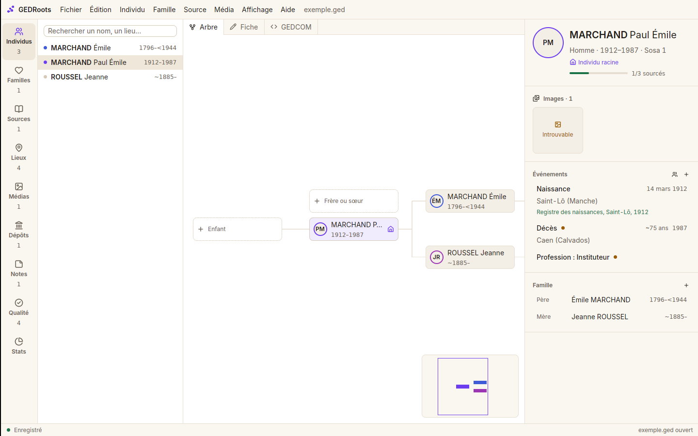
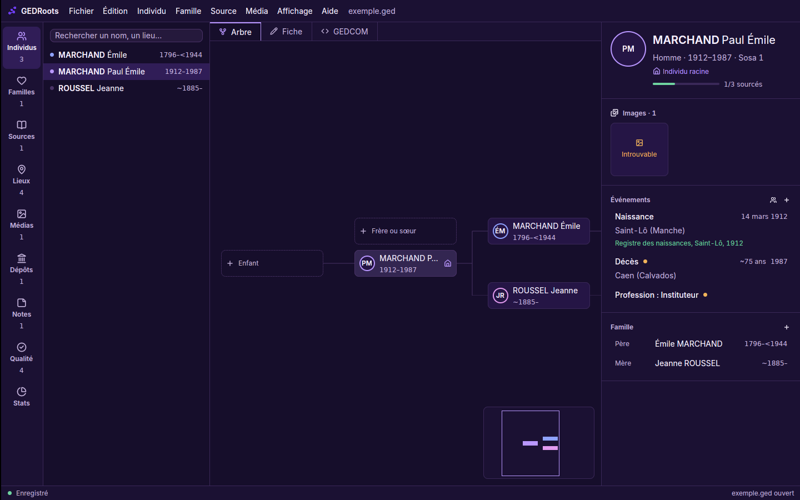

# Design system GEDRoots

Tiré du kit de marque GEDRoots v1.0 (« graphe organique, minimaliste, violet »). Le code
de référence est [`crates/gedroots/src/theme.rs`](crates/gedroots/src/theme.rs) : les vues
n'écrivent jamais de couleur, de rayon ni de police en dur, elles passent par ses jetons.

| Clair | Sombre |
|---|---|
|  |  |

## Principes

- **Fonds neutres, une pointe de violet** : les fonds restent blanc et ocre en clair, gris et
  noir en sombre. Le violet primaire n'apparaît que par touches : action principale, lien,
  sélection, symbole de marque. Jamais de fond ni de grand aplat violet, pas de dégradé.
- **Commandes dans les menus** : pas de barre d'outils. Les seuls boutons visibles sont les
  petits « + » des en-têtes de section et les emplacements pointillés de l'arbre.
- **Pas de texte explicatif** : un titre par élément ; les exemples de format vont dans le
  placeholder des champs ; les sections vides sont masquées.
- **Une seule barre en haut** : sous macOS, la barre de titre est fondue dans celle de l'app
  (feux tricolores à gauche, déplacement de la fenêtre). Le nom du fichier n'y figure qu'une
  fois, centré, suivi de « • » tant qu'il n'est pas enregistré. Pas de barre d'état : les
  messages s'affichent à droite de la barre du haut.
- **Infobulles** sur tout bouton sans libellé, avec le raccourci quand il existe.
- **Jamais la couleur seule** : lignées, états et sélections ont aussi une forme (point,
  contour, icône, texte). Les couleurs restent lisibles par les daltoniens.

## Couleurs

Le mode suit l'apparence du système et change à chaud. `GEDROOTS_APPEARANCE=light|dark` le
force (captures, tests).

| Jeton (`theme::`) | Rôle | Clair | Sombre |
|---|---|---|---|
| `bg()` | Canevas principal | `#FFFFFF` | `#141414` |
| `panel()` | Barres, panneaux latéraux | `#FAF7F1` | `#1A1A1A` |
| `surface()` | Cartes, champs | `#F4EFE6` | `#222222` |
| `hover()` | Survol, sélection discrète | `#EEE7DA` | `#2B2B2B` |
| `border()` | Séparateurs | `#E6DED0` | `#2E2E2E` |
| `border_strong()` | Contours de champs, cases | `#D5CAB7` | `#3D3D3D` |
| `text()` | Texte principal | `#1F1B16` | `#ECECEC` |
| `muted()` | Texte secondaire | `#6B6257` | `#A3A3A3` |
| `accent()` | Violet : actions, liens, sélection | `#6D3DF0` | `#B997FF` |
| — survol / pressé | Boutons primaires | `#5B2BDD` / `#4C21B8` | `#C8AAFF` / `#A77CF6` |
| `on_accent()` | Texte sur le violet | `#FFFFFF` | `#1A1A1A` |
| `accent_soft()` | Ligne sélectionnée | violet 10 % | violet 16 % |
| `paternal()` | Lignée paternelle | `#3F5BD8` | `#8FA2FF` |
| `maternal()` | Lignée maternelle | `#9C36B5` | `#E39BF0` |
| `ok()` | Succès, « sourcé » | `#1A7346` | `#6FD3A0` |
| `warn()` | À vérifier | `#9A5B00` | `#F0B35A` |
| `danger()` | Erreur, suppression | `#C42B48` | `#F2828E` |
| `scrim()` | Voile sous les modales | noir 35 % | noir 55 % |
| `viewer()` | Fond des visionneuses d'actes | `#0E0E0E` | `#0E0E0E` |
| `image_*()` | Cadres et étiquettes posés sur une photo | couleurs sombres, fond noir 72 % | idem |

Les neutres clairs tirent vers l'ocre, les sombres sont des gris purs.

Le de cujus (Sosa 1) prend le violet ; les deux lignées restent dans la gamme violette
(indigo côté père, orchidée côté mère) au lieu d'introduire d'autres couleurs fortes.

Contrastes (WCAG) : tout texte courant dépasse 4,5:1 sur `bg`, `panel` et `surface` dans les
deux modes (violet sur blanc 5,9:1 ; muted 5,2:1 sur surface ; texte sombre 13,5:1 sur surface). Les couleurs d'état
et de lignée dépassent aussi 4,5:1 sur `bg`.

Le thème des composants gpui-component (boutons, listes, menus, tableaux, champs) est rempli
à partir de ces jetons dans `theme::apply`.

## Typographie

- **Inter**, embarquée dans l'app (Regular, Medium, SemiBold, Bold ; licence SIL OFL dans
  `crates/gedroots/assets/fonts/OFL.txt`). Le rendu est le même sur macOS, Linux et Windows.
- **Chiffres tabulaires** activés sur toute la fenêtre (`theme::tabular_nums()`), pour aligner
  dates et effectifs.
- Graisses : 400 texte, 500 libellés, 600 titres et noms, 700 réservé.
- Échelle (px) : 12 `text_xs` (métadonnées, listes denses) · 14 `text_sm` (texte courant) ·
  16 base · 20 `text_xl` (titres de fiche) · 24 `text_2xl`. Pas de 18 px.
- Libellés en casse de phrase, courts.

## Espacements

Pas de 4 px : 4, 8, 12, 16, 24, 32, 48, 64 — soit `gap_1`, `gap_2`, `gap_3`, `gap_4`, `gap_6`,
`gap_8`… (idem `p_*`, `px_*`, `py_*`). `0p5` (2 px) est toléré pour un écart vertical entre deux
lignes de texte ; pas de `1p5` ni de `2p5`.

## Rayons

| Jeton | Valeur | Usage |
|---|---|---|
| `RADIUS_SM` | 8 px | Champs, puces, vignettes, cases de l'arbre, cartes de section (aussi `Theme.radius`) |
| `RADIUS_MD` | 12 px | Boutons, menus, popovers (`Theme.radius_lg`) |
| `RADIUS_LG` | 20 px | Fenêtres modales (palette de commandes, ajout d'un proche…) |

Le kit prévoit aussi 28 px pour de grands panneaux superposés : à introduire si l'app en a un.
Bordures 1 px `border()` ; focus : anneau `accent()`.

L'anneau de focus (3 px) est peint hors de la bordure du champ : une zone qui défile le coupe si le
champ touche son bord. Une zone qui défile et contient des champs s'écrit donc
`theme::scroll_y(id)` (retrait `FOCUS_ROOM` compensé par une marge négative, l'alignement ne
bouge pas) ou garde un `p_*` intérieur d'au moins 4 px ; jamais un `overflow_y_scroll()` nu
autour d'un champ.

## Icônes

- **Interface** : icônes Lucide (jeu de gpui-kit + `ExtraIcons` dans `main.rs`), 16 px dans les
  listes et en-têtes, 14 px dans le texte, couleur `muted()` ou `accent()` quand actif.
- **Marque** : sources SVG du kit dans `crates/gedroots/assets/brand/`, chargées par
  `img("brand/…")`.
  - `icon-micro.svg` : symbole simplifié pour 16–32 px (barre du haut) ;
  - `icon-primary.svg` : symbole détaillé dès 48 px ;
  - `logo-horizontal-light.svg` / `-dark.svg` : écran d'accueil, selon le mode.
- Ne jamais redessiner, recolorer ni entourer le symbole d'une forme ajoutée.
- L'icône d'application (`.icns`, `.ico`, PNG) relève de `packaging/`.

## Graphes (arbre, éventail, carte)

- Lien de parenté proche : trait plein ; ascendants colorés par lignée, descendants et
  collatéraux neutres (`border_strong()`).
- Sélection : contour `accent()` + fond `accent_soft()`, jamais une simple teinte.
- Liens : courbes ou coudes discrets, épaisseur homogène.

## Ajouter un jeton

Ajouter le rôle dans `Palette` (valeurs claire **et** sombre), une fonction d'accès, puis le
documenter ici. Vérifier le contraste à 4,5:1 sur `bg`, `panel` et `surface`.
