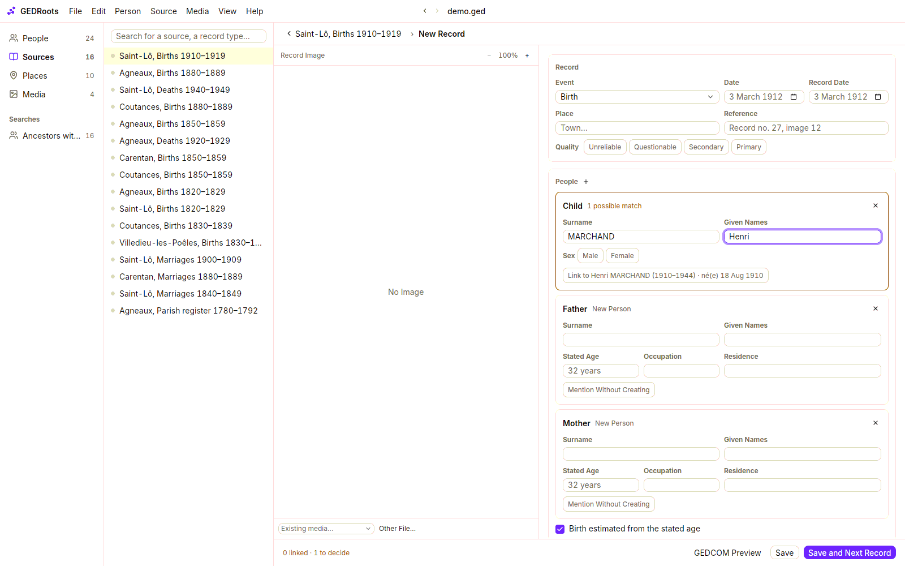

In this tutorial, you create a new family tree with your first generations, and enter a birth record that names you and your parents. By the end, you'll know the habit GEDRoots is built around: **enter what a record says, in the record's source**.

You need GEDRoots [installed](/get-started/install). Have one real document at hand if you can, such as a birth certificate. If not, follow along with invented names.

<Steps titleSize="h3">
  <Step title="Create the tree">
    Open GEDRoots and click **Start a New Tree**, or select **File › New Tree…**.

    The **New Tree** window is laid out as a small pedigree: you on the left, your parents, then your four grandparents. Enter what you know: given names, surname, and dates the way you say them (`14 March 1952`, `March 1952`, `about 1952`, `before 1952`). For yourself, also choose your sex and enter your birth place. Leave a box empty when you don't know the person: nobody is created for it.

    A father's surname can be left empty: he takes his child's, shown in grey in the field. If the tree isn't about you, click **You** at the top of the first box and choose **Someone Else**.

    Click **Create Tree**. GEDRoots creates everyone with their families and opens the tree on you. You are the **root person**: the one the tree opens on, and the starting point of Sosa numbers.

    The first time, the tour offers three short chapters: the main parts of the window, entering a record from its source, and reviewing what an AI agent proposes (the last two in the sample tree, with a demo). Press <kbd>Esc</kbd> to leave it; **Help › Take the Tour** brings it back. To try things out without touching your tree, use **Help › Open Sample Tree**.

    Select **File › Save** and choose where to keep your `.ged` file. A folder of its own is a good idea: GEDRoots stores record images next to the file.
  </Step>

  <Step title="Create the source">
    Select **Source › New Source**. GEDRoots opens a new source on an empty record.

    In the source's details, give it a **Title** that says what the document is, such as `Birth certificate of Paul Martin`. If you got it from an archive or a town hall, create the **Repository** too: that's where you or someone else would find the original again.
  </Step>

  <Step title="Enter the record">
    In the record editor:

    1. Under **Event**, choose **Birth**. Enter the **Date** and the **Place** of the birth, and a **Reference** if the document has one, such as `Record no. 112`.
    2. Under **People**, the record already has a **Child**, a **Father** and a **Mother**. Type the names as the document writes them.
    3. As you type, GEDRoots looks for matching people in your tree and the menu next to each role says how many it found. Open it and choose the person you entered when creating the tree: the likely ones are listed first.

    

    If the document mentions a stated age, an occupation or a residence, enter them in the person's fields: GEDRoots records each one as a dated, sourced fact.
  </Step>

  <Step title="Attach the image and save">
    Drag the scan or photo of the document onto the editor, or click **Other File…**. Then click **Save**.

    GEDRoots writes the birth event, cites the source on each person with their role, and attaches the image. Open your own details: the birth now shows the source under it, and the progress bar under your name counts it as sourced.
  </Step>
</Steps>

## What you've learned

- A tree is a single `.ged` file. **File › Save** writes it; GEDRoots keeps the previous version as a `.ged.bak` copy next to it.
- You start a tree with its first generations in one window, then add relatives from a person, with the **+** next to **Family** or the empty boxes of the tree.
- You enter a record **once, in its source**. GEDRoots turns it into events, family links and citations for everyone it names.

## Next steps

<CardGroup cols={2}>
  <Card title="Find your way around" href="/get-started/workspace" icon="layout">
    The sidebar, the three views of a record, and the command palette.
  </Card>
  <Card title="Record what a source says" href="/workflows/records" icon="book-open">
    Roles, witnesses, censuses, and going through a whole register.
  </Card>
</CardGroup>
