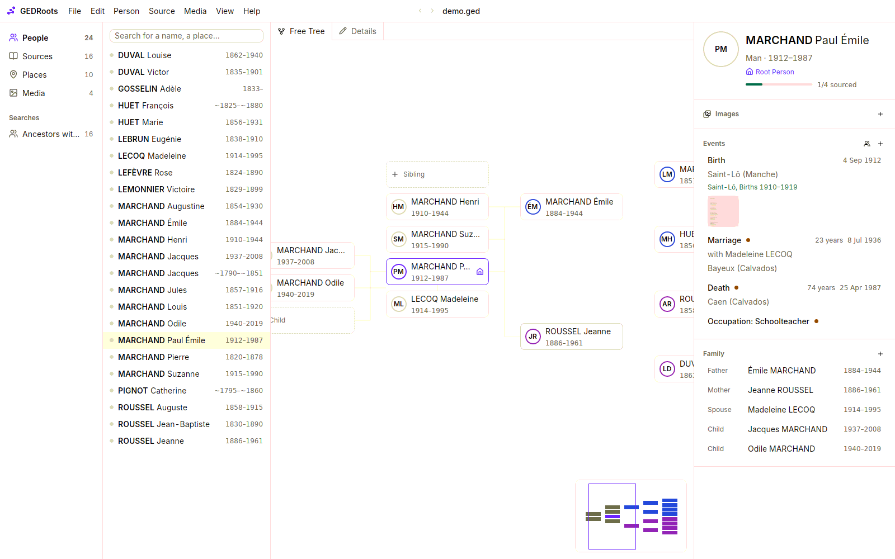
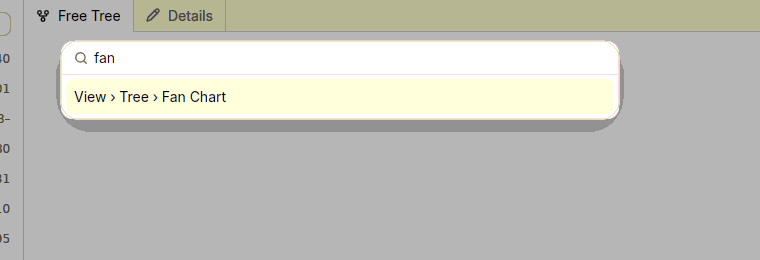

GEDRoots shows one tree per window. The window is split in four columns, from the most general to the most specific.

## The four columns

**Sidebar.** The four kinds of records you work with every day: **People**, **Sources**, **Places** and **Media**, each with its count. Below them, your **Searches**. To hide the sidebar, select **View › Show or Hide Sidebar** (<kbd>⌃⌘S</kbd> on macOS, <kbd>Ctrl+Alt+S</kbd> on Windows and Linux).

**List.** The records of the selected kind, with a search field on top. The count in the sidebar follows the search, so you always know how many records match.

**Main view.** For people, the tree or the fan chart; for places, the map. Sources, media, repositories and notes are read here in full. The **View** menu switches the view:

| Command | Shows | Shortcut (macOS / Windows and Linux) |
| --- | --- | --- |
| **Tree** | The person in the free tree or the fan chart | <kbd>⌥⌘1</kbd> / <kbd>Ctrl+Alt+1</kbd> |
| **Details** | A source, media, repository or note, back from its raw GEDCOM | <kbd>⌥⌘2</kbd> / <kbd>Ctrl+Alt+2</kbd> |
| **Raw GEDCOM** | The record's GEDCOM lines, editable, with validation and autocompletion. Opens in a tab you can close. | <kbd>⌥⌘3</kbd> / <kbd>Ctrl+Alt+3</kbd> |

**Details panel.** The record of the selected person or place: a person's portrait, images, timeline of events and family; the records that use a place. Every name in it is a link. To change a name, the sex, the birth, the death or the note, click the pencil next to the name (<kbd>⌘L</kbd> / <kbd>Ctrl+L</kbd>): the top of the panel turns into fields, in place. **Done** saves, **Cancel** or <kbd>Esc</kbd> drops the changes.

Repositories, shared notes, **Data Quality** and **Statistics** are not in the sidebar. Open them from the **View** menu, or follow a link from a record that uses them.

## Three ways to run a command

Every command in GEDRoots lives in the menu bar. There is no toolbar: the screen is for your data.

- **The menu bar.** File, Edit, Person, Source, Media, View, Help. On macOS, the menus are in the system menu bar; on Windows and Linux, at the top of the window. A command that doesn't apply to the current record is dimmed.
- **The command palette.** Press <kbd>⌘⇧P</kbd> on macOS or <kbd>Ctrl+Shift+P</kbd> on Windows and Linux, then type a few letters of any command. Accents and case don't matter.

  

- **Right-click.** Right-click a row, a box in the tree, an event, a relative, a thumbnail or a map marker to act on it directly, without selecting it first. Right-click the empty part of a list to create a record.

## Move between records

Every name is a link: click a parent in the details panel, a person in a source, a place in an event. To retrace your steps, use the arrows of the top bar (<kbd>⌘[</kbd> and <kbd>⌘]</kbd> on macOS, <kbd>Alt+←</kbd> and <kbd>Alt+→</kbd> on Windows and Linux), like in a web browser.

Each list remembers the last record you opened in it. **Person › Go to Root Person** (<kbd>⌘⇧H</kbd> / <kbd>Ctrl+Shift+H</kbd>) brings you back to the root of the tree from anywhere.

## Undo anything

Every change can be undone with **Edit › Undo** (<kbd>⌘Z</kbd> / <kbd>Ctrl+Z</kbd>), up to 50 steps back: a deleted person, a merged place, a bulk fix from the Data Quality page. Changes are written to disk only when you save.

## Related pages

- [Keyboard shortcuts](/reference/shortcuts)
- [All commands](/reference/commands)
