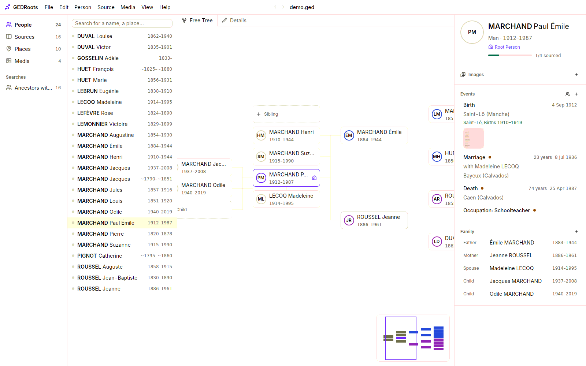

GEDRoots helps you build a family tree from the records you find: birth, marriage and death registers, censuses, military files, photos. It is built for the way genealogists actually work. You read a record, you note what it says about each person in it, you cite where you found it, and you move on to the next record.

## What makes GEDRoots different

- **Your file is the database.** GEDRoots reads and writes a `.ged` file in [GEDCOM 7](https://gedcom.io), the open standard of genealogy. There is no hidden database, no account and no cloud. You can open the same file in other software tomorrow.
- **Nothing is lost.** A file that GEDRoots opens and saves stays identical, byte for byte, apart from your changes. Tags that other programs wrote are kept even when GEDRoots does not use them.
- **Sources come first.** You enter a record once, in its source, with everyone it names. GEDRoots writes the events, the family links and the citations for you.
- **Local and private.** GEDRoots works offline. It only goes online when you ask it to: map tiles, a place lookup, a website search.

## What you can do

<CardGroup cols={2}>
  <Card title="Start a tree" href="/get-started/first-tree" icon="sprout">
    Create a file, add your family and enter your first record in ten minutes.
  </Card>
  <Card title="Bring in an existing tree" href="/workflows/import" icon="file-input">
    Open a GEDCOM file from Ancestris, Heredis, RootsMagic or any other program.
  </Card>
  <Card title="Record what a source says" href="/workflows/records" icon="book-open">
    Enter a birth, marriage or census record once, with every person it names.
  </Card>
  <Card title="Organize scans and photos" href="/workflows/media" icon="images">
    File record images by event and name them consistently, automatically.
  </Card>
  <Card title="Find what is missing" href="/workflows/research" icon="search">
    List the ancestors without a birth record and search them on archive websites.
  </Card>
  <Card title="Check your data" href="/workflows/quality" icon="list-checks">
    Spot impossible dates, broken links and duplicate places, and fix them in one click.
  </Card>
  <Card title="Research with an AI agent" href="/workflows/ai-agents" icon="bot">
    Let an AI agent look for records in online archives. You review every proposal.
  </Card>
  <Card title="Share your tree" href="/workflows/share" icon="share-2">
    Send the tree with its media, or publish it on Geneanet.
  </Card>
</CardGroup>

## How this documentation is organized

- **[Get started](/get-started/install)** takes you from installation to your first sourced record.
- **[Workflows](/workflows/import)** explain how to accomplish a genealogy task, step by step.
- **[Concepts](/concepts/gedcom-7)** explain how GEDRoots stores your research and why.
- **[Reference](/reference/shortcuts)** lists shortcuts, search criteria, checks and file extensions.

The interface is in English and French. GEDRoots follows the language of your system.
