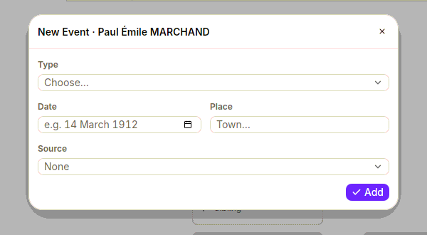
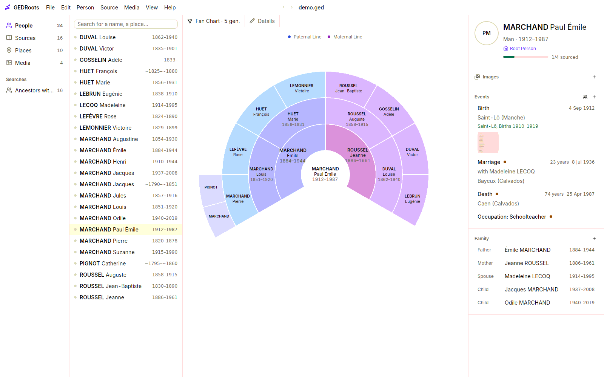

Most of a tree grows from records: when you [enter a record](/workflows/records), GEDRoots creates or links everyone it names. This page covers the rest: adding a relative by hand, linking two people, and recording events that don't come from a single record.

## Add a relative

1. Open the person.
2. In the details panel, click **+** next to **Family**.
3. In the **Relatives** window, pick the relationship (**Father**, **Mother**, **Spouse**, **Child**, **Sibling**) and click:
   - **New Person** to create the relative. GEDRoots opens their details so you can fill them in.
   - **Existing Person…** to link someone already in your tree.

The same commands are in **Person › Add Relative** and **Person › Link Existing Person**. In the free tree, the dashed boxes (**+ Sibling**, **+ Child**, an empty parent) do the same: click one to create the person, right-click it to link an existing one.

When you link an existing person, the picker lists first the people whose dates make sense for that relationship. You can type search criteria in it, such as `born:1850 place:agneaux`. See [Search criteria](/reference/search-criteria).

GEDRoots keeps both sides of every link consistent: a child added to a family is listed in it, and the family is listed on the child. A spouse added to a parent who has no partner yet joins that parent's existing family, with its children.

## Manage unions

GEDRoots has no separate list of families. A union is managed from the record of either spouse:

- Union events, such as a marriage or a divorce, appear in each spouse's timeline, **with** the other spouse.
- The union's photos and notes appear in each spouse's details.
- To add a child to a couple, click **+** next to **Family** on either parent. A person with several unions gets one **Child with …** choice per union.

A union that ended in a divorce or an annulment shows its years next to the spouse, for example `1932–1950`.

### Detach a person

To remove a link without deleting anyone, right-click the relative in the details panel and choose **Detach from Parents**, **Detach from This Union** or **Remove This Child**. A family left with no members is deleted.

## Record life events

1. Open the person.
2. Click **+** next to **Events**, or select **Person › Add Event…**.
3. Choose the **Type**: birth, baptism, occupation, residence, military service… For a union event, also choose the **Union**.
4. Enter the **Date** and **Place**, and the **Source** if you have one.
5. Click **Add**.

To correct an event, click it in the timeline: it reopens in the same window. Its notes, media and other citations are kept. To delete it, right-click it and choose **Delete Event**.

For an event that has no standard GEDCOM type, choose **Other…** and type its name, such as `Pilgrimage`. GEDRoots stores it as a standard `EVEN` with a `TYPE`, and offers it again next time. You can rename or merge these types in [File Settings › Events](/workflows/file-settings#events).

:::tip[Sourced or not?]
An event entered here has no source unless you pick one. When you have the document, [enter the record](/workflows/records) instead: GEDRoots writes the event, the citation and the roles of everyone involved in one go.
:::

## Read a life as a timeline

The **Events** section of a person is a single list, by date, that mixes:

- the person's own events, with their age at each one;
- the events of their unions (marriage, divorce…), with the spouse's name.

Click the people icon next to **+**, or select **View › Relatives' Events**, to add the births and deaths of their parents, siblings, spouses, children and grandchildren during their lifetime. You see at a glance that a woman lost her mother the year she married, or that a man was the last of his siblings.

## Explore the tree

The **Tree** view shows the selected person in one of two charts. Switch with **View › Tree › Free Tree** or **Fan Chart**.

**Free tree.** Ancestors to the right, descendants and spouses to the left, siblings above. Drag to move around or use the mouse wheel; generations load as you go, in both directions. The minimap shows where you are. Double-click a person to center the tree on them.

**Fan chart.** The ancestors of the person, paternal line on one side and maternal line on the other, from 2 to 7 generations. Change the depth with **View › Tree › More Generations** (<kbd>⌘=</kbd> / <kbd>Ctrl+=</kbd>) and **Fewer Generations** (<kbd>⌘-</kbd> / <kbd>Ctrl+-</kbd>). Empty boxes show at a glance which ancestors you haven't found yet.

Right-click any box to open, edit or add a relative from there.

## Find how two people are related

1. Open one of the two people.
2. Select **Person › Relationship With…** and choose the other person.

GEDRoots names the relationship (“second cousin”, “first cousin once removed”, “half-brother”, “father-in-law”) and shows the path through the common ancestors, with the civil degree. In French, it uses the French terms, such as « cousin issu de germain ».

## Related pages

- [Record what a source says](/workflows/records)
- [Find people and records](/workflows/search)
