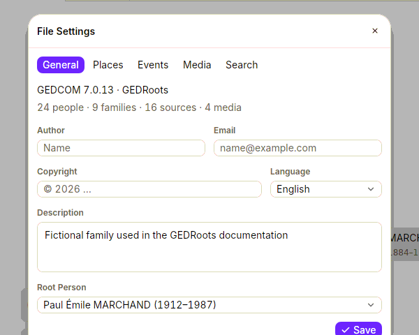

Settings that describe your tree belong to the tree. GEDRoots stores them in the header of your `.ged` file, so they travel with it: open the file on another computer and everything is as you left it.

To open the settings, select **GEDRoots › File Settings…** (<kbd>⌘,</kbd> / <kbd>Ctrl+,</kbd>).

## General

| Setting | What it's for |
| --- | --- |
| **Author**, **Email** | Who maintains the tree. Other people who receive your file know whom to contact. |
| **Copyright** | The rights you reserve on your research. |
| **Language** | The main language of the file's content. |
| **Description** | A note about the tree as a whole. |
| **Root Person** | The person the tree opens on, the reference for Sosa numbers, relationships and “ancestors of the root person”. |

All of these are standard GEDCOM 7 header fields, which other software reads. Every time you save, GEDRoots also records itself and the date in the header.

## Places

The place format: the list of jurisdictions every place is made of, such as **Town**, **Postcode**, **County**, **Region**, **Country**. Changing it rewrites every place in the file. See [Pin down places](/workflows/places#choose-your-place-format).

## Events

GEDCOM 7 has a fixed list of event types: birth, marriage, occupation… Anything else, such as a military service or a first communion, is a generic event with a type that you name. The **Events** tab lists the custom types found in your file, separately for individual and family events.

For each custom type, you can:

- **rename** it: every event of that type is updated. Renaming it to an existing type merges the two;
- give it a **Label**, shown in GEDRoots instead of the type written in the file. For example, events typed `military service` can show as “Military Service”;
- remove it, if no event uses it.

Click **Add a Type** to declare a type you haven't used yet, so that it's offered in **Add Event…**.

## Media

The media folder, its subfolders, what each one receives and how files are named. See [Organize scans and photos](/workflows/media#file-images-automatically) and [Media naming templates](/reference/media-naming).

## Search

The websites offered in **Person › Search On**, with the address template of each one. See [Plan your research](/workflows/research#add-your-own-websites).

## Related pages

- [GEDCOM extensions](/reference/gedcom-extensions): how GEDRoots stores the settings that GEDCOM 7 has no field for
