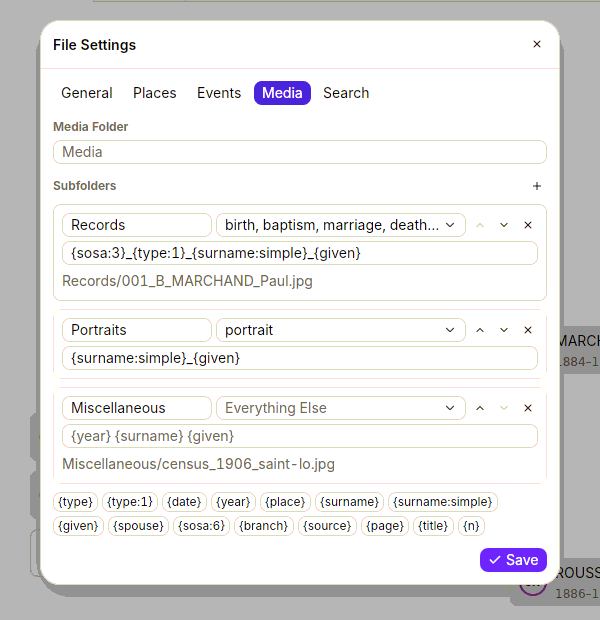
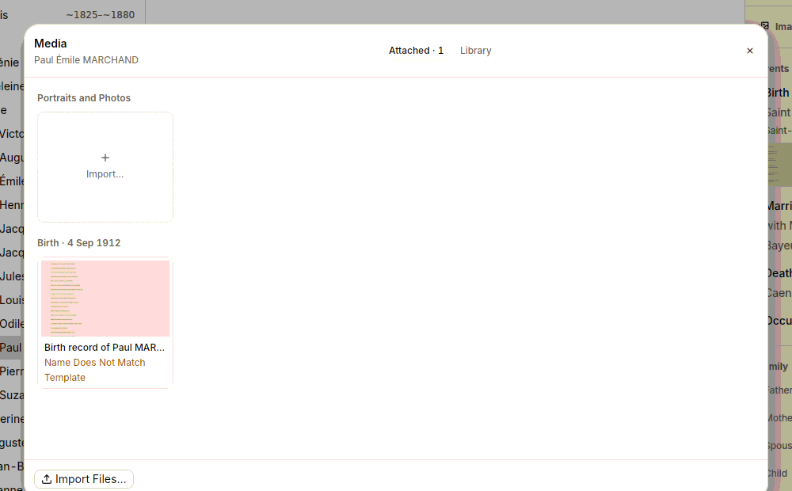

A tree collects hundreds of images: record scans, census pages, portraits, military files. GEDRoots keeps them as ordinary files next to your `.ged` file and can file and name them for you, so your folder stays tidy without effort.

## File images automatically

Tell GEDRoots once how you want your media folder organized. Every image you import afterwards lands in the right subfolder, under a consistent name.

1. Select **GEDRoots › File Settings…**, then the **Media** tab.
2. In **Media Folder**, enter the folder that holds your media, relative to the `.ged` file, such as `Media`.
3. Click **+** next to **Subfolders** to add one, such as `Records`.
4. In the menu next to its name, select what it receives: event types (birth, marriage, death, military service…), **portrait** for photos attached to a person, or **Everything Else**.
5. Under it, type the naming template, such as `{sosa:3}_{type:1}_{surname:simple}_{given}`. The example below the template shows the name a real media of your file would get.
6. Click **Save**.

With the settings above, the birth record of Paul MARCHAND, Sosa 1, is filed as `Media/Records/001_B_MARCHAND_Paul.jpg`. The variables and their options are listed in [Media naming templates](/reference/media-naming).

Files you import from elsewhere are copied into place. Files already in your media folder are moved and renamed. A name already taken gets `(2)`, `(3)`… These settings live in your `.ged` file, so they travel with it.

### Tidy existing media

To apply the template to a media you imported before, open it and select **Media › Rename Using Template…**. GEDRoots shows the new names and asks for confirmation before moving the files. In the media window, a media whose file names don't follow the template is marked **Name Does Not Match Template**.

## Attach images

The fastest way is to drag files from your file manager:

- onto a **person** or a **source**, to attach them to it;
- onto an **event** in a person's timeline, to attach them to that event;
- onto the **record editor**, when you [enter a record](/workflows/records#attach-the-records-image).

For more control, right-click a record and choose **Record Media…** (<kbd>⌘⇧M</kbd> / <kbd>Ctrl+Shift+M</kbd>) to open the media window. It works on that record:

- **Attached** lists the media of the record, grouped by event.
- **Library** lists every media in your file, with a search field (title, file name, person). Select media and click **Link** to attach them to the record.
- **Import Files…** adds files from your disk. Before importing, you choose whether to **Copy** or **Move** them, and whether several files form **One Media** with several pages.
- **Suggested** lists files in your folder whose name contains the person's name, and that no media uses yet.

To attach the media you're looking at to another record, select **Media › Attach This Media To…**.

## Handle records on several pages

A marriage record on two sheets, or a military file of four pages, is a single media with one file per page. GEDCOM 7 supports this natively, and other software reads it.

- Turn the pages with <kbd>Page Up</kbd> and <kbd>Page Down</kbd>, or click the thumbnails.
- Add pages by dropping files on the media, or right-click it and choose **Add Pages…**.
- Reorder pages by dragging their thumbnails, or with **Move Page Left** and **Move Page Right**.
- **Split Page into New Media** and **Remove Page from Media** take a page out. A removed page's file stays on disk.

### Merge media that are really one

If you imported each page as its own media, merge them:

1. In the **Media** list (<kbd>⌘4</kbd> / <kbd>Ctrl+4</kbd>), select the media in page order: <kbd>⌘</kbd>-click or <kbd>Ctrl</kbd>-click each one, or <kbd>Shift</kbd>-click a range.
2. Right-click the selection and choose **Merge Selected Media**, or select **Media › Merge Selected Media**.

Every link to the merged media is rewritten, citations included. A person you framed on the second page keeps their frame.

## Find files that nothing uses

Your folder may hold scans you never attached. Select **Media › Files to Attach**: GEDRoots lists the files in the `.ged` folder that no media points to. Open one to attach it, or create a media for each in bulk from the [Data Quality](/workflows/quality) page.

## Browse your media

The **Media** list shows every media in your file. Above it, a row of types (**All**, **Records**, **Portraits**…) follows the subfolders of your media settings. Web links have their own type. Use the search field for anything else: `event:birth`, `person:marchand`, `format:pdf`, `without:link`. See [Search criteria](/reference/search-criteria#media).

## Related pages

- [Identify people in photos](/workflows/photos)
- [Media naming templates](/reference/media-naming)
