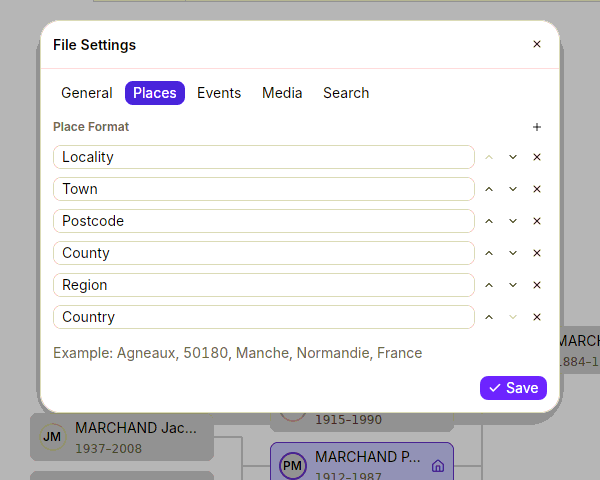
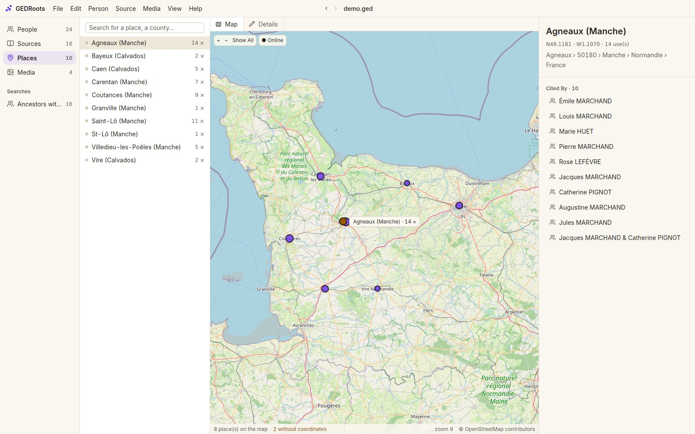
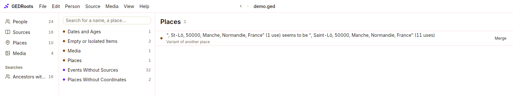

The same village written three ways is three villages to a search engine. GEDRoots helps you enter each place once, in the same format, with its coordinates, so that maps, searches and exports stay reliable.

## Choose your place format

A place is a list of jurisdictions, from the most precise to the widest, such as `Agneaux, 50180, Manche, Normandie, France`. Set the list once for your file:

1. Select **GEDRoots › File Settings…**, then the **Places** tab.
2. Rename, reorder, add or remove jurisdictions, such as **Locality**, **Town**, **Postcode**, **County**, **Region**, **Country**.
3. Click **Save**.

Every place in the file is rewritten to the new format, and the window shows a preview first. This is a single change you can undo.

GEDRoots uses the format everywhere: each jurisdiction gets its own field in a place's details, and places are shown in short form, such as `Agneaux (Manche)`.

## Enter a place

Wherever you type a place (an event, a record, a residence), the menu suggests, in this order:

1. places already in your file;
2. a locality inside a place you know, such as `Le Moulin, Agneaux`;
3. **Real Places** from OpenStreetMap, while you're online;
4. **Create “…”**, to create the place as typed.

Choosing a real place or **Create “…”** opens the **New Place** window. It has one field per jurisdiction of your format, already filled in, and a map: click it to drop the pin. Click **Create Place**.

Picking places from the menu, rather than typing them in full, is what keeps them consistent.

## Place your places on the map

The **Places** list (<kbd>⌘3</kbd> / <kbd>Ctrl+3</kbd>) shows every place in your file with its number of uses. Its **Map** view shows the places that have coordinates.

On the map, drag to move, use the wheel to zoom, and click a marker to open the place. **Show All** fits every place on screen.

To give coordinates to a place that has none, open it, then:

- click **Locate**: GEDRoots suggests matching real places, and you pick the right one; or
- click **Place on the Map**, then click the spot on the map; or
- right-click the map where the place is and choose **Place “…” Here**.

GEDRoots never locates all your places in one go. Homonyms are too common (France has dozens of villages called Saint-Martin), so you confirm each place. The **Places Without Coordinates** category of [Data Quality](/workflows/quality) lists the ones left to do.

To move a marker, right-click it and choose **Move by Hand…**.

## Work offline

Map tiles are downloaded from OpenStreetMap the first time you see them, then kept on your disk. Click **Online** above the map to switch to **Offline**: GEDRoots then shows only the tiles it already has and makes no connection. See [Privacy and network use](/concepts/privacy).

## Rename or merge places

Open a place and click the pencil next to its name (<kbd>⌘L</kbd> / <kbd>Ctrl+L</kbd>) to edit its jurisdictions in the panel: every event that uses it is updated. Renaming a place to the name of another place merges them.

To find places written several ways, open **Data Quality** in the sidebar and choose **Places**. GEDRoots lists:

- **variants** of the same place: different case or accents, `St` and `Saint`, a postcode in one and not the other. Click **Merge** to keep the most used one.
- **inconsistent hierarchies**, such as `Loire` sometimes in `Rhône-Alpes` and sometimes in `Auvergne-Rhône-Alpes`. Click **Harmonize** to keep the most frequent.

## Remove a place

Select the place and choose **Edit › Delete Place** (<kbd>⌘⌫</kbd> / <kbd>Delete</kbd>), or right-click it in the list. GEDRoots removes the place from every event that uses it; the events themselves stay. Click **Undo** in the status bar to bring it back.

## Find places

The search field of the **Places** list understands a few criteria: `in:manche` for every place within a county, `without:coordinates` for the ones still to locate. See [Search criteria](/reference/search-criteria#places).

## Related pages

- [Set up a file](/workflows/file-settings)
- [Check and clean your data](/workflows/quality)
