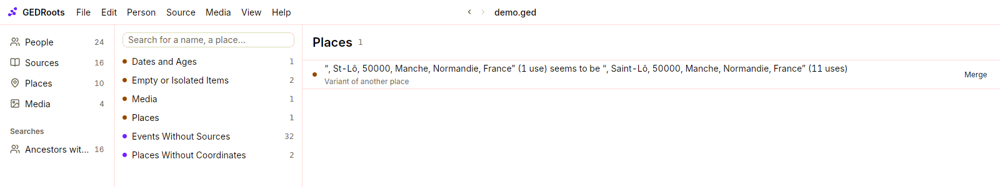

Every tree accumulates mistakes: a typo in a year, a family link half-deleted by an old program, a scan moved to another folder. The **Data Quality** page finds them for you and fixes most of them in a click.

## Open the Data Quality page

Select **View › Data Quality** (<kbd>⌘7</kbd> / <kbd>Ctrl+7</kbd>). Issues are grouped by category, with their count:

| Category | Finds |
| --- | --- |
| **Dates and Ages** | Death before birth, a mother aged 9 or 60 at a birth, a marriage before 14, a person in their own ancestry… |
| **Family Links** | A child listed in a family that doesn't list them back, a husband recorded as a woman |
| **GEDCOM Structure** | Tags not allowed where they are, required information missing, unreadable dates, links to records that don't exist |
| **Empty or Isolated Items** | Empty events and notes, families with no members, sources and media used nowhere, people with no link to the root person |
| **Media** | Files not found, files moved within your folder, two media pointing at the same file, a file with no format |
| **Places** | The same place written differently, a county attached to two regions |
| **Events Without Sources** | Every event that cites no source |
| **Files to Attach** | Files in your folder that no media uses |
| **Places Without Coordinates** | Places you haven't located on the map yet |

The full list of checks, with their thresholds, is in [Data quality checks](/reference/quality-checks).

Imprecise dates are treated fairly: `about 1850` or `between 1820 and 1825` are only reported if the problem holds for every possible date in the range.

## Fix an issue

Click an issue to open the record it concerns. Correct it there, then press <kbd>⌘[</kbd> / <kbd>Alt+←</kbd> to go back to the list.

When the fix is safe and obvious, the issue has a button that applies it directly:

| Button | Does |
| --- | --- |
| **Restore Link** | Adds the missing half of a family link |
| **Remove Link** | Removes a link to a record that doesn't exist |
| **Fix Path** | Points a media to where its file actually is |
| **Infer Format** | Sets the file format from the extension |
| **Create Media** | Creates a media for a file nobody uses |
| **Merge** | Merges a place variant, or duplicate media, into the most used one |
| **Harmonize** | Gives every use of a place the most frequent hierarchy |
| **Delete** | Deletes an empty event, note or family, or a record used nowhere |
| **Locate…** | Lets you pick the file of a missing media, or opens a place on the map to locate it |

A category whose issues all have the same fix shows a button to fix them all at once, such as **Fix All Paths** or **Delete Empty Events**. GEDRoots asks for confirmation before deleting or merging anything, and each bulk fix is a single change you can undo.

## Hide an issue you've checked

Some issues are real history, not mistakes: a girl really married at 13, a man really lived to 112. Right-click the issue and choose **Hide**. GEDRoots records in your file that you checked it, and stops reporting it.

To see hidden issues again, select **View › Filter List › Ignored Issues**. Right-click one and choose **Stop Hiding** to report it again.

Issues about files and places can't be hidden: there is no record to note it in.

## Make it a habit

Open the page after an import, after a long session of data entry, and before you share your tree. A clean tree exports cleanly to other software and to Geneanet.

## Related pages

- [Data quality checks](/reference/quality-checks)
- [Pin down places](/workflows/places)
