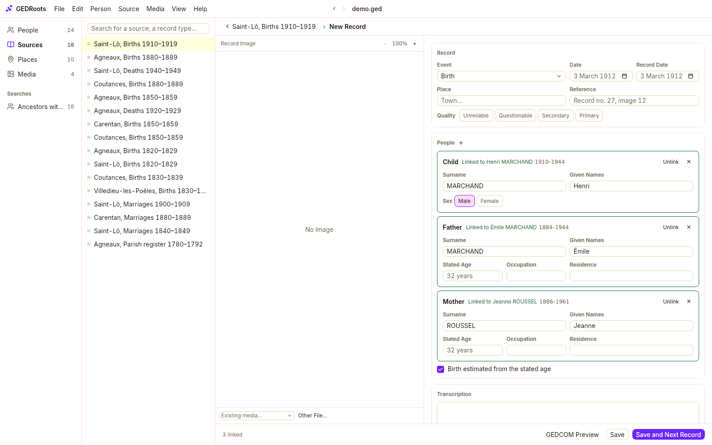
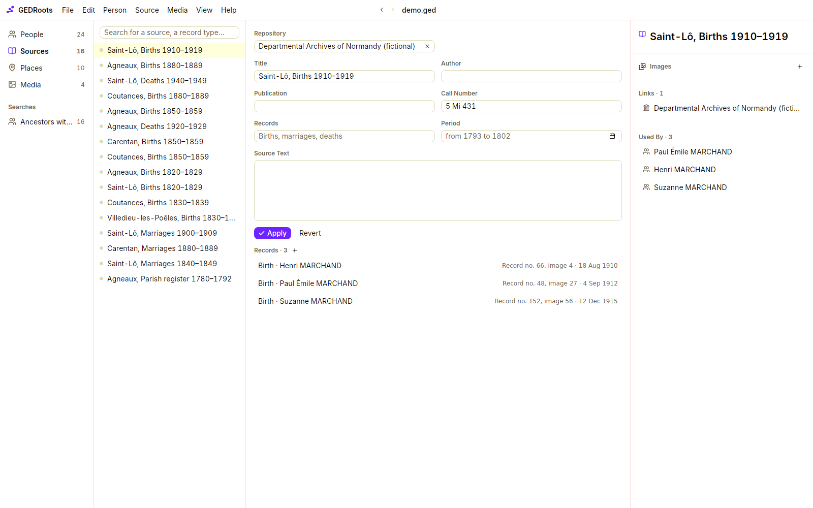

Genealogists don't think in people first. They read a record, and the record names several people: a child and the parents, two spouses and their witnesses, a whole household. GEDRoots lets you enter it that way: **one record, in its source, with everyone in it**.

## Before you begin

Decide how you cite registers. Both habits are common, and GEDRoots supports both:

- **One source per register** (`Saint-Lô, Births 1910–1919`), with the record number as the citation's reference.
- **One source per record** (`Birth record of Paul MARCHAND`).

The [Sources and citations](/concepts/sources-and-citations) page explains the trade-off. Whatever you choose, be consistent within a register.

## Create the source and its repository

1. In the **Sources** list, click **Create** in the top bar (<kbd>⌘N</kbd> / <kbd>Ctrl+N</kbd>). GEDRoots creates the source and opens an empty record in it.
2. Click the source's name at the top to go back to it, and fill in its **Details**:
   - **Title**: what the document is, such as `Saint-Lô, Births 1910–1919`.
   - **Repository**: where the original is kept. Choose one, or create it with **Create** in the **Repositories** list.
   - **Call Number**: the reference of the document in the repository, such as `5 Mi 431`.
   - **Records** and **Period**: what the register holds and the years it covers. GEDRoots fills them in for you as you enter records.

To reuse a source, open it from the **Sources** list (<kbd>⌘2</kbd> / <kbd>Ctrl+2</kbd>). Its page lists every record already entered from it.

## Enter a record

1. Open the source and click **+** next to **Records** (<kbd>⌘E</kbd> / <kbd>Ctrl+E</kbd>).
2. In the **Record** section:
   - **Event**: the event the record attests, such as **Birth**, **Marriage**, **Death** or **Census**. For anything else, choose **Other Event…** or **Other Family Event…** and type its name.
   - **Date** and **Place** of the event.
   - **Record Date**, when the record was written later than the event, such as a birth declared three days after.
   - **Reference**: where the record is in the source, such as `Record no. 27, image 12`.
   - **Quality**: how much you trust the record for this event, from **Unreliable** to **Primary**, or **—** if you don't say.
3. In **People**, GEDRoots has already added the roles the event needs: a **Child**, a **Father** and a **Mother** for a birth (plus a **Godfather** and a **Godmother** for a baptism); a **Husband**, a **Wife** and both sets of parents for a marriage. Remove a role you don't need with **Remove from Record** in the menu next to it. Fill in each person as the record writes them: **Surname**, **Given Names**, **Stated Age**, **Occupation**, **Residence**, **Born in** (each field's name stays inside it), and **Male** or **Female** when the role doesn't say.
4. To add someone else, click **+** next to **People** and choose their role: **Witness**, **Godfather**, **Godmother**, **Informant**, **Officiant**, **Neighbor**…
5. For each person, decide what to do (see [Link, create or mention](#link-create-or-mention)).
6. Optional: paste or type the **Transcription**.
7. Click **Save**.

To check what will be written, select **View › GEDCOM Preview** before saving.

### Link, create or mention

As you type a name, GEDRoots looks for the people who match it: same name (even with the surname and given names swapped), a plausible age, and the links the tree already knows. The menu next to the person's role then says how many people match, such as **2 possible matches**.

For each person, open that menu (or right-click the person) and choose one of three things:

| Choice | When | What GEDRoots does |
| --- | --- | --- |
| A possible match, or **Other Person…** | The person is already in your tree. | The likely people are listed with why they fit (such as `parent of Henri MARCHAND`); **Other Person…** opens the list of all your people. The one you choose gets the event or the citation, and the menu shows their name. |
| **New Person** | The person is new and belongs in your tree. | Creates them when you save. This is the default. |
| **Mention Without Creating** | A witness or a neighbor you don't want as a person in the tree. | Writes their name, role and details in a note of the citation. |

In a marriage, the role of each parent says whose parent they are, such as **Father of the husband**; click it to change.

The counter at the bottom, such as `2 linked · 1 to decide`, tells you how many people are still to decide.

### What GEDRoots writes when you save

- The event, on the main person (or on the couple's family for a marriage), with its date, place and the citation.
- The family links that follow from the roles: the **Father** and **Mother** of a child become their parents; a **Husband** and **Wife** form a couple.
- A citation on every person, with their **role** in the record.
- Witnesses, godparents and informants as associates of the main event, with their role.
- Each stated occupation and residence as a dated, sourced fact. A stated age becomes the person's age at the event, and, if **Birth estimated from the stated age** is selected, an estimated birth (`about 1880`).

Everything is standard GEDCOM 7. Other genealogy programs read it.

## Attach the record's image

Drop the scans or photos of the record anywhere on the editor, or click **Change Image** under the image:

- choose one of the source's images, or **Other Media…** to pick an image already in your file;
- choose **Other File…** to pick files on your disk;
- choose **No Image** to enter the record without one.

Several files make a single media with several pages, such as a marriage record on two sheets. A file you already imported is reused, never duplicated. When you save, GEDRoots files the images in your media folder and names them after your [naming template](/workflows/media#file-images-automatically).

You can also start from the images: right-click the source and choose **Record Media…** (<kbd>⌘⇧M</kbd> / <kbd>Ctrl+Shift+M</kbd>), select the files and click **Enter a Record from Images…**.

## Go through a whole register

When you index a register, record after record:

1. Enter the first record.
2. Click **Save and Next Record**.

GEDRoots saves the record and opens a new one in the same source. It keeps the event type, place, image and quality, and increases the first number of the reference: `Record no. 27` becomes `Record no. 28`.

## Enter a census or another household record

For a census, choose the **Census** event and add the household members with the roles **Head of Household** and **Household Member**. Type each member's **Stated Relationship** as written, such as `wife` or `son`: GEDRoots links each one to the head of household accordingly.

## Correct or delete a record

On the source's page, click a record to reopen it in the editor. Saving it replaces its citations. To delete a record, right-click it and choose **Delete Record**: its citations and associations are removed, while the events and the people stay in the tree.

Records entered in other software appear in the list too: GEDRoots rebuilds the list from the citations that point to the source, grouped by reference.

## Add a web link

For a record you consulted online, keep a link to its page in the archive's viewer. Click **+** next to **Web Links** in the details panel, then enter the **Address** and a **Title**. The link opens in your browser with a click.

## Related pages

- [Sources and citations](/concepts/sources-and-citations)
- [Organize scans and photos](/workflows/media)
- [Research with an AI agent](/workflows/ai-agents)
