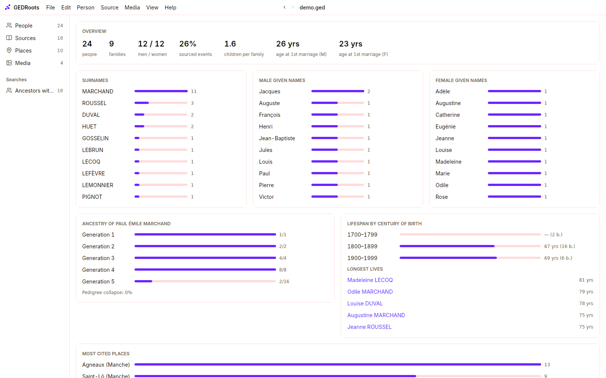
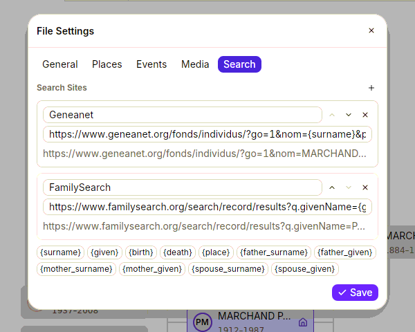

Research goes faster when you know what you are looking for. GEDRoots helps you find the gaps in your tree, then opens the right search on the websites you use.

## See how complete your ancestry is

Click **Statistics** in the sidebar (<kbd>⌘9</kbd> / <kbd>Ctrl+9</kbd>). The **Ancestry** chart counts, for each generation above the root person, how many ancestors you've found out of how many there are: 2 parents, 4 grandparents, 8 great-grandparents… The first generation that drops tells you where to dig.

The page also shows the most frequent surnames, given names and places, lifespans by century, ages at first marriage and pedigree collapse: the share of ancestors who appear more than once in your tree.

## List what is missing

Combine searches to turn a vague “I should find more records” into a list:

| To find | Search the **People** list for |
| --- | --- |
| Ancestors with an unsourced event | **Person › Find Ancestors** on the root person, then `without:source` |
| People without parents | `without:parents` |
| Couples with no marriage recorded | `without:marriage` |
| People with no dates at all | `without:date` |
| Your first six generations | `sosa:1-63` |

[Save the searches](/workflows/search#save-a-search) you'll come back to: they stay in the sidebar with their number of results, which goes down as you work.

The **Events Without Sources** category of [Data Quality](/workflows/quality) lists every event without a source, one by one, and opens each with a click.

## Search a person on the web

GEDRoots opens a person's search on genealogy websites, already filled in with their name, dates and places.

1. Open the person, or right-click them anywhere.
2. Select **Person › Search On**, then the website.

Your browser opens on the results. Geneanet and FamilySearch are set up by default.

### Add your own websites

You can add any website whose search page takes the name in its address: a departmental archive, a regional indexing project, a search engine.

1. Select **GEDRoots › File Settings…**, then the **Search** tab.
2. Click **+** next to **Search Sites**.
3. Enter the **Site Name** and the address of a search, with variables in braces where the person's data goes.

For example, `https://www.google.com/search?q="{given} {surname}" {place}` searches Google for the exact name and the birth town. The preview under each address shows it filled in with the current person.

| Variable | Replaced with |
| --- | --- |
| `{surname}`, `{given}` | The person's surname and first given name |
| `{birth}`, `{death}` | Years of birth and death |
| `{place}` | Town of birth |
| `{father_surname}`, `{father_given}`, `{mother_surname}`, `{mother_given}` | The parents' names |
| `{spouse_surname}`, `{spouse_given}` | The spouse's name |

The sites are saved in your `.ged` file. A variable with no value is left empty.

## Keep track of what you find online

When you find a record in an online archive, keep the way back to it:

- add a **web link** to the page of the record in the archive's viewer, on the source or on the person (**+** next to **Web Links**);
- [enter the record](/workflows/records) with its reference, so the citation says exactly which page to open.

## Let an AI agent do the legwork

An AI agent connected to GEDRoots can read the gaps in your tree, search the archives for you and propose the records it finds. You review each one before it enters your tree. See [Research with an AI agent](/workflows/ai-agents).

## Related pages

- [Find people and records](/workflows/search)
- [Check and clean your data](/workflows/quality)
