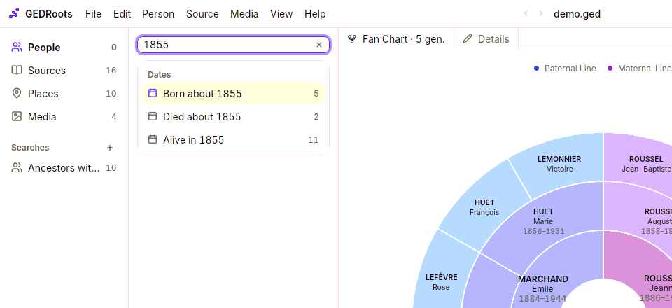
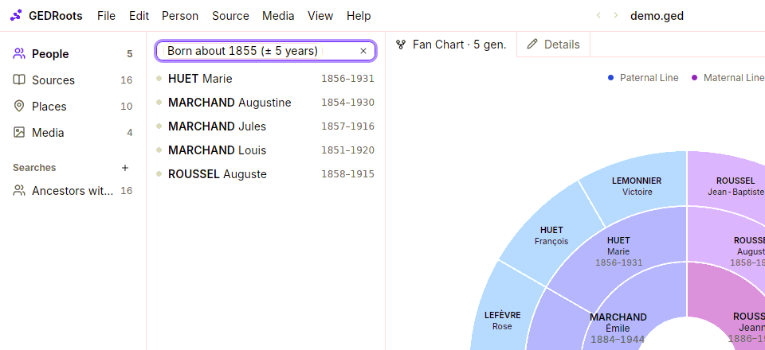

Each list in the sidebar (people, sources, places, media) has its own search field. Type plain words; GEDRoots understands names, places, years and kinship, and turns each criterion into a token you can adjust.

## Search with plain words

1. Click the search field above the list, or press <kbd>⌘F</kbd> / <kbd>Ctrl+F</kbd>.
2. Type what you know: a name, a place, a year, an occupation.
3. Pick a suggestion with the arrow keys and <kbd>Return</kbd>, or click it.

Accents and case never matter: `lefevre` finds `LEFÈVRE`. Each suggestion shows how many records it would find.

Some examples of what to type:

| You type | GEDRoots suggests |
| --- | --- |
| `1855` | **Born in 1855**, **Born about 1855** (± 5 years), **Died about 1855**, **Alive in 1855** |
| `agneaux` | **Place Agneaux**, and the people with that name |
| `miller` | **Occupation miller** |
| `louis marchand` | **Ancestors of Louis MARCHAND**, **Descendants of…**, **Spouses of…**, **Children of…**, **Parents of…**, **Siblings of…** |

Each criterion you pick becomes a token in the field. Tokens add up: `Born about 1855` and `Place Agneaux` find the people born around 1855 **and** linked to Agneaux. The count next to **People** in the sidebar shows the number of results.

## Adjust a token

Click a token to change it:

- On a year, choose the margin: **Exactly**, **± 2**, **± 5** or **± 10 years**.
- On a name, select **Include Variants** to also find spellings that sound the same, such as GUYOT, GUYAU and GUILLOT. This uses a French phonetic key, suited to French records.

To remove a token, click it and choose to remove it. **View › Filter List › Clear Search** empties the field.

## Type criteria directly

If you prefer, type criteria as keywords: `born:1850-1860 place:agneaux sex:f`. They are the same in every interface language. The most useful ones:

| Criterion | Finds |
| --- | --- |
| `born:1800-1850`, `died:<1900`, `alive:1870` | People by dates |
| `name:marchand`, `name:=marchand` | A surname with its variants, or exactly |
| `without:source`, `without:parents`, `without:marriage` | What is still missing |
| `sosa:1-63` | The first six generations of ancestors of the root person |

The full list, for each kind of record, is in [Search criteria](/reference/search-criteria).

## Use quick filters

Click the empty search field to see ready-made criteria for the list, each with its number of results: for people, **Men**, **Women**, **Ancestors of the Root Person**, **Without Sources**, **Without Parents**, **Without Dates**, **Unions Without Marriage**, **With Media** and more. Click one to add it to the field.

## Find ancestors and descendants

To list everyone descended from a person, open them and select **Person › Find Descendants**. **Person › Find Ancestors** does the same upwards. The result is an ordinary search: add more criteria to it, such as `without:source` to see which ancestors still lack a source.

## Save a search

A search you run often, such as *ancestors without a birth record*, can be kept in the sidebar:

1. Run the search.
2. Click **+** next to **Searches** in the sidebar.
3. Type a name, or keep the one GEDRoots proposes from the tokens.

A saved search shows its number of results and updates as you work. Double-click it to rename it; right-click it to delete it. Saved searches are stored in your `.ged` file, so they follow the file to another computer.

## Related pages

- [Search criteria](/reference/search-criteria)
- [Plan your research](/workflows/research)
